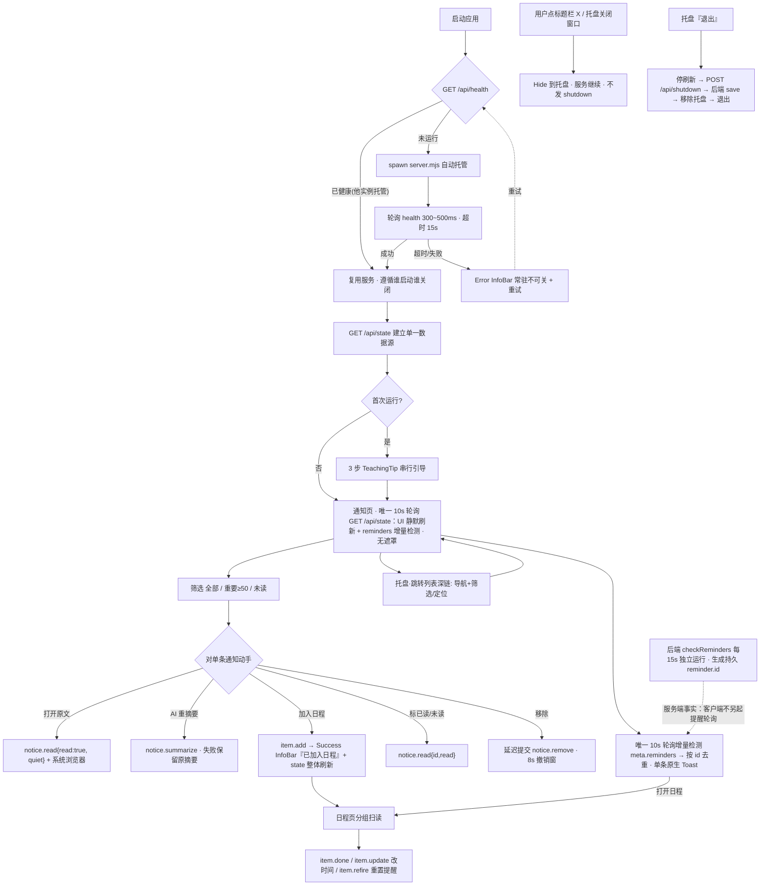
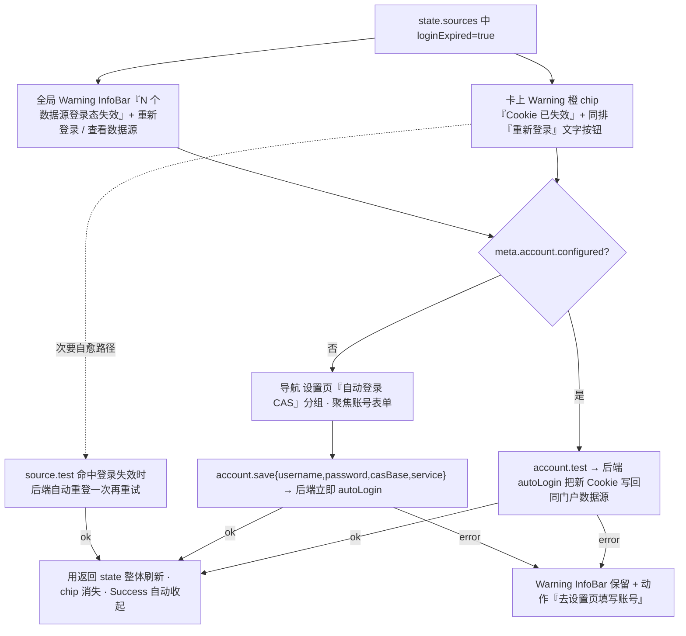
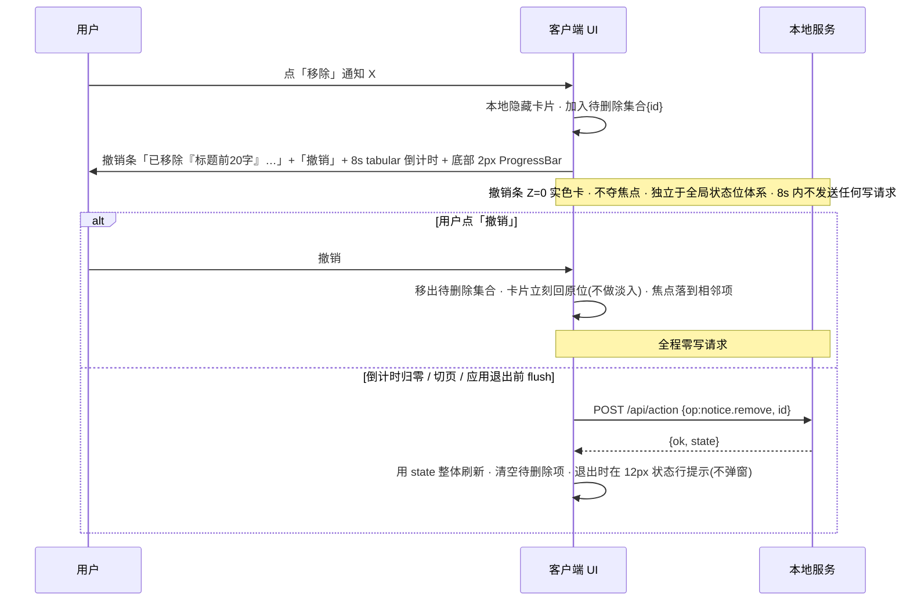

# BJUT-News-Grabber · WinUI 3 体验与交互规范（Phase 2）

> 版本 1.0 ｜ 体验设计专家（ux-ui-designer）产出 ｜ 目标：原生 WinUI 3 / Windows App SDK / Fluent / Mica 桌面客户端
>
> **本文边界**：只定义「用起来是什么样」——信息架构、交互流程、状态流、响应式、无障碍、错误与撤销、Phase 3 交接口径。**不定义色彩/字体/断点数值**（全部沿用 Phase 1），**不写任何 C#/XAML 实现代码**，**不定义新 API**、**不新增后端能力**。所有动作必须映射到本文与《后端真实契约》中已存在的 `op`。
>
> **上游依据**：`docs/winui3-visual-spec.md`（Phase 1，12 节，782 行，已完整阅读）。凡本文与 Phase 1 冲突，一律**以 Phase 1 为准**，冲突与承接关系登记在附录 C。
> **行为参考**：`public/app.js` / `public/index.html`（现有 Web 版）、`server.mjs` / `store.mjs` / `core.mjs`（后端真实实现，已逐行核对关键分支）。
>
> **下游用途**：Phase 3（前端实现）按第 10 节逐项落地与验收；`frontend-design-architect` 的架构决策按第 10.0 节的「架构侧确认项」对齐。

---

## 0. 一句话结论与拍板事项登记

**四页平级导航不建返回栈；所有写操作以 op 回传的全量 `state` 为唯一真值整体刷新；删除类动作用「即时移除 + 8s 撤销条」替代二次确认（无恢复 op 且连带配置的数据源/账号才用 ContentDialog）；六种全局状态只走「顶部 1 条 InfoBar + 标题下状态行」（撤销条**独立于全局状态位体系**，非例外、非第 5 种状态，不受最多 1 条择一逻辑影响）；桌面增强只做快捷入口与到点提醒，不复制页面功能；四处（设置页/托盘/跳转列表/首次引导）零开机自启。**

### 0.1 主理人已拍板的两项决策（写入规范，不再讨论）

| # | 决策 | 落地口径 | 与 Phase 1 / Web 版的关系 |
| --- | --- | --- | --- |
| **D1** | **「重要」筛选阈值统一为 `score >= 50`** | 「重要」= `ScoreHigh(50–69 关注)` + `ScoreCritical(70–100 重要)` 两档；UI 必须**明示「重要：关注度 ≥ 50」**；徽标读法沿用 Phase 1 §2.4/§7.4 四档文字 + score 数字 + 形状 | Phase 1 §2.4 的「⚠️ 需确认」项**已拍板为 50**，视觉规范无需修改，本文按其默认 50 设计。**与现有 Web 版 `app.js` L231/L234 的 `>= 55` 是有意差异**：Web 版会把 50–54 分的橙色「关注」档排除在「重要」之外，与 70/50/35 四档错位。**不改后端、不改现有 Web 版**，仅 WinUI 客户端按 50。详见 §3.1 |
| **D2** | **`loginExpired` 用 Warning 橙（可操作待办），不用 danger 红** | 红色只留给**服务断连、整体抓取失败**等阻断性状态；`loginExpired` 必须配套明确的「**重新登录**」动作入口（卡片内文字按钮 + 全局 Warning InfoBar 动作按钮） | 与 Phase 1 §2.6 / §7.7 / §7.9 一致（Phase 1 已把 Web 版 danger 改判 Warning）。本文补齐动作落点与 op 映射，详见 §5.5 |

### 0.2 后端事实核对结论（Phase 2 新增，供 Phase 3 直接采信）

| 事实 | 出处 | 对交互的影响 |
| --- | --- | --- |
| **所有 `/api/action` 的 op 都回传全量 `state`，包括 `ok:false` 时**（`poll` 已在抓取中、`source.test` 失败、`account.test` 失败、`item.add` 校验失败等均带 `state`） | `store.mjs` `act()` L646–969；`server.mjs` L241–313 | 客户端**不需要维护复杂本地数据模型**：一次 op 成功后直接用返回 `state` 整体刷新；**失败也必须应用 `state`**（失败常伴随部分状态变更，如 `source.status='error'`、`lastLogin` 更新）。`GET /api/state` 仅用于启动与**唯一 10s 轮询**（UI 静默刷新 + reminders 增量检测，§0.3） |
| `source.test` 成功额外返回 `preview[]`（最多 5 条 `{title,url,date}`） | `store.mjs` L912–917 | 预览**内联展示在该源卡下方**，不弹模态；见 §5.4 |
| `source.test` 命中「登录态失效」时会**自动重登一次再重试**并把 `loginExpired` 置回 false | `store.mjs` L918–935 | 「测试」是登录失效的**次要自愈路径**；「重新登录」是主路径，语义更明确，见 §5.5 |
| `settings.save` 末尾调用 `this.restartTimers()`，会清空并重建抓取/提醒定时器、立即跑一次 `checkReminders()` | `store.mjs` L940–960, L1031–1047 | 每次保存都**重置抓取倒计时**；开关即时保存必须防抖 + 串行化，表单必须显式一次性保存，见 §6.2 |
| `item.update` 改 `dueAt` 或 `remindBefore` 会清空 `fired[]`；`item.refire` 显式清空 `fired[]` | `store.mjs` L788–805, L820–827 | 「改时间」自带重新武装提醒的语义，UI 需明示；「重置提醒」仅在 `fired.length > 0` 时出现，见 §4.4 |
| `item.add` 成功返回 `{ ok, message, id, state }` | `store.mjs` L786 | `item.add` 是**已提交 + 有反向 op**（`item.remove{id}`）的**新增型**动作，**不套用撤销条**（§13.3 的前提是「无恢复 op → 延迟提交」）。反悔只需到日程页删除，删除本身有 8s 撤销条兜底，见 §3.4 / §9.2 |
| **不存在任何「恢复已删除通知/日程/数据源」的 op** | 契约全表 | 删除类撤销只能靠**延迟提交**（撤销窗口内不发请求）；数据源/账号清除必须 ContentDialog 二次确认，见 §9 |
| `meta.account` 只含 `{username, casBase, service, configured, lastLogin}`，**从不返回密码**；`configured = canAutoLogin()` | `store.mjs` L1006–1012, L284–287 | 密码一律 PasswordBox 不回显，placeholder「已保存（留空不修改）」；`configured` 决定「重新登录」按钮的落点，见 §5.5 / §6.5 |
| `notices` 最多 200 条、`items` 最多 300 条（后端 `slice`） | `store.mjs` L1000–1001 | 达到上限时列表尾部需 12px 提示「仅显示最近 200 条通知」，避免用户误以为丢数据，见 §3.7 |
| `checkReminders()` 每 15s 跑一次，`recordReminder` 生成**持久 `reminder.id`**；`settings.notify===false` 时不发系统通知 | `store.mjs` L601–642, L1038–1046 | 客户端按 `reminder.id` 去重，避免同一提醒反复弹 Toast，见 §1.6 / §10.0 |
| `/api/shutdown` 立即回 `{ok:true}`，80ms 后执行 `stop() → await save() → rm(RUNTIME_PATH) → server.close → exit` | `server.mjs` L316–323, L394–411 | 客户端收到响应即可继续退出；**数据在每次写 op 后已落盘**，故 shutdown 失败可降级放行，见 §7.5 |
| `source.add` 的 `type` 只接受 `html/rss/json`（`wechat` 仅在 `fetchSource` 内部存在，不接受新增） | `store.mjs` L830, L143 | 新增表单**只提供 3 个选项**，不得暴露 `wechat`，见 §5.3 |

### 0.3 与视觉规范 v1.1 的同步（Phase 2 修订登记）

`frontend-design-architect` 已把 `docs/winui3-visual-spec.md` 修订为 **v1.1**（新增 §13 增补章，为权威修订；**所有色彩 / 字体 / 间距 / 断点 / 圆角数值 v1.0 → v1.1 一个未改**，§10 Token 表可照抄，本文「视觉全部沿用 Phase 1」依然成立）。本文据 §13 同步以下 5 处，**同步后两份规范对同一交互的描述一致**：

| # | 同步项 | 本文位置 | v1.1 依据 |
| --- | --- | --- | --- |
| **S1** | **撤销载体**：`TeachingTip`（Acrylic / Z=32）→ **「撤销条 / Undo Bar」**（内容区底部居中、最大宽 480、实色卡 + 1px 描边、圆角 8、**Z=0 无投影、不用 Acrylic**） | §2.3 / §3.5 / §4.5 / §9.2 / §9.3 / §10 R1 / §10.9 / 附录 A | §13.3 新增组件 7.14 |
| **S2** | **确认策略分叉显式化**：通知移除 / 日程删除 = 8s 撤销条，**不弹 ContentDialog**；删除数据源 / 清除已保存账号 = **仍用 ContentDialog**。这是全应用唯一的确认策略分叉 | §9.3 / §5.6 / §10.9 | §13.2 覆盖表 / §7.10 |
| **S3** | **A4 在途忙态 5 条**写入设置页 4 个行为开关的即时保存（乐观值不回弹 / 邻侧 14px `ProgressRing` / 同组开关短暂禁用 / 防抖窗不重复 ring 与吐司 / 失败回滚到 InfoBar Error 不弹窗 / 成功后不叠加 Success 吐司） | §6.2 / §9.1 / §10.9 | §7.8「在途忙态」 |
| **S4** | **A3 启动时序**：复用已有健康服务时**不显示**「正在连接本地服务…」，直接进正常态；仅真正等待本实例 spawn 时才显示 | §7.2 / §10.9 | §13.2 / §7.12 |
| **S5** | **A1 通道无关**：后端托管 Toast 时取消「打开日程」按钮，改由点击 Toast 本体 + 客户端激活事件跳转；**D1 明示落点**改为「筛选行**下方**一行 12px Caption + 『重要』项 `ToolTip` / `AutomationProperties.Name`」，<640 DIP 只保留后者，**不塞进药丸项** | §1.6 / §10.0 A1 / §3.1 | §13.4 / §13.2 |

> **效力**：视觉表现与组件策略以 **v1.1 §13 为准**；本文只定义交互与状态语义。A1–A5 的**架构方案本身**由 team-lead / 主理人 / Phase 3 拍板，本文与 v1.1 均不越界代选（v1.1 §13 边界声明同此）。**A1 已于本轮裁定，见下条登记。**

> **A1 裁定登记（主理人拍板 · 方案甲）**：**A1 已定：方案甲 —— 客户端按 `reminder.id` 去重消费 `meta.reminders` 发 `AppNotification`，带「打开日程」激活按钮并深链到日程页；后端由客户端托管时传 `server.mjs --no-toast` 静默 `onNotify`（不带参数时默认行为不变，Web 版零影响）；设置页「测试桌面通知」走客户端 ToastService 自测，不调用 `notify.test`。同一 `reminder.id` 全程只允许一条系统 Toast。**
> 两份规范正文**保持「通道无关」表述**（§1.6 / §10.0 A1 / §10 R9 / §10.9 Toast 行不改），以便复用他实例服务时保留降级描述。`notify.test` 仍是后端 `POST /api/action` 的既有 op（回传全量 `state`），供 Web 版与复用他实例服务时使用；WinUI 客户端「测试桌面通知」按钮按上句走 **ToastService 自测**（§6.6 已同步）。**效力**：本条 A1 登记为最终口径，**高于 §6.2 显式按钮清单 / §9.1 失败表 / §10.9 验收表中沿用 Web 版语境列出的 `notify.test`**；那些位置仅表示该 op 存在、可回传 `state`，按「不要改动 §10.9」的指令保留原样。以上为主理人裁定的 Phase 3 实现口径，本文仅登记，**不定义新 API**。

> **轮询口径登记（全应用唯一轮询）**：客户端**只有一条 10s 轮询**——`GET /api/state` 每 **10s 一次**，**同时承担 ① UI 静默刷新 与 ② `meta.reminders` 增量检测**（按 `reminder.id` 去重后发 Toast）。后端 `checkReminders()` 每 15s 独立运行属**服务端事实**（`store.mjs` L1038–1046），`reminder.id` 持久且 `state` 保留前 20 条 reminders，因此客户端**不需要也不得另起 15s 提醒轮询**，不会漏提醒。**保留 §9.5 的 state 单调序号与「写操作在途暂停合并静默刷新」**。文中所有「10s 静默刷新」一律按本条理解为该唯一轮询，不再存在第二个提醒轮询。

---

## 1. 信息架构（交付项 1）

### 1.1 NavigationView 四页层级

```
窗口 (Mica 根层, 唯一)
└─ NavigationView (PaneDisplayMode = Auto, 窗格透明)
   ├─ PaneHeader 品牌区：icon 24×24 + 「校园通知 · 日程」+ 12px 状态摘要「服务运行中 · 端口 8737」
   ├─ 4 个平级顶级页（无父子、无栈）
   │   ├─ 通知   (Ringer)   InfoBadge = 未读数 (Informational)，0 隐藏，>99 显示 99+
   │   ├─ 日程   (Calendar) InfoBadge = 24h 内到期未完成数 (Caution)，0 隐藏
   │   ├─ 数据源 (Globe)    无徽标
   │   └─ 设置   (Setting)  固定 PaneFooter
   └─ 内容区（不透明 Layer 1，最大宽 940 / 设置 720）
```

- **四个页面是平级关系，不是层级钻取**。因此 `IsBackButtonVisible = Collapsed`（Phase 1 §7.1）：**不出现系统返回箭头**，也不建立返回栈。
- 页面标题 28px 每页唯一；状态行 12px 常驻（Phase 1 §7.2）。
- PaneFooter 上方 12px 状态摘要只显示服务/端口/上次抓取，**不放任何托盘开关、自启开关**（硬约束）。

### 1.2 每页分区（命令区 / 次区 / 主区 / 浮层）

沿用 Phase 1 §8 的视觉线框，本节只补充**交互落点**，不重画视觉。

| 页 | 命令区（CommandBar 48，标题右侧） | 次区（标题下 / 列表上或下） | 主区（列表） | ① 瞬态浮层（Acrylic，Z=32/64）<br>② 底部撤销条（卡片层 Layer 2，Z=0，实色 + 1px 描边，**不用 Acrylic**；仅层叠位置浮于列表底部，**不叠 ThemeShadow**） |
| --- | --- | --- | --- | --- |
| **通知** | 「立即抓取」`poll`（主按钮，MinWidth 120）／「开启桌面通知」（通知授权引导，非自启）／溢出「…」＝按关键词重算摘要 `notices.rescore`、补齐通知正文 `notices.refill{limit:40}` | ① 标题下 12px 状态行；② 最多 1 条 InfoBar；③ 筛选 Segmented 三段 +「全部标已读」；④ 筛选行下方 12px Caption「重要 = 关注度 ≥ 50 的通知」（<640 隐藏，改由 ToolTip/Name 承担） | 通知卡片流（MinHeight 96）；空/错误态占位 | `CommandBarFlyout`（卡内 More）、**8s 撤销条**（底部居中，§9.2）、TeachingTip（首次指引） |
| **日程** | 「＋ 手动添加日程」（展开内联表单）／「显示已完成」开关／右端「共 N 项待办」 | ① 状态行（含橙色「N 项 24 小时内到期」）；② InfoBar；③ 内联添加表单（折叠时不占位） | 分组列表（组头吸顶、行 MinHeight 56） | More Flyout、**8s 撤销条**（§9.2）；ContentDialog 仅用于 ≤4 字段短表单 |
| **数据源** | 「＋ 添加数据源」（展开内联表单）／溢出「…」＝全部重新登录 `account.test`、去设置页 | ① 状态行；② InfoBar；③ 内联添加表单（展开时）；④ 底部 12px 说明区（校内网/WebVPN/DNS 覆盖/JSON 解析） | 4 张预置源卡片（MinHeight 88）+ 新增卡片 | 内联 `Expander` 编辑卡（长表单，**不用 ContentDialog**，Phase 1 §7.10）、ContentDialog（删除确认）、TeachingTip（预览指引） |
| **设置** | **无命令栏主按钮**（Phase 1 §8.4）；每组右下「保存设置」 | ① 状态行；② InfoBar；③ 五个分组卡片（720 宽） | 分组内的开关行 / 输入行 / 只读状态区 | ContentDialog（清除账号、清空 Key 确认）；保存反馈由**顶部 Success InfoBar**（自动收起）承担，**不叠加吐司** |

### 1.3 页内导航与返回语义

1. **无系统返回键**：四页平级，`IsBackButtonVisible = Collapsed`；不用 Alt+← / 系统 Back 做页间返回。
2. **页内「返回」用内容区文字按钮**，不用系统返回箭头。仅以下场景存在：
   - 数据源编辑 `Expander` 展开 → 「取消 / 保存」就地收起（无导航）。
   - 日程 / 数据源内联添加表单 → 「取消」就地收起。
   - 设置页 CAS 分组被「重新登录」深链跳转进入 → 提供内容区「返回上一页」文字按钮，回到**进入前的页面**（记录来源页，不建栈）。
   - InfoBar / TeachingTip 的动作按钮（「查看数据源」「打开设置」）→ 导航到目标页；返回同样用「返回上一页」文字按钮。
3. **深链激活语义**（托盘菜单 / 跳转列表 / 原生 Toast）：激活窗口 → 导航到目标页 → 应用目标筛选或滚动定位。**深链不压入返回栈**，不改变「四页平级」结构。
4. **跨入口不重复渲染**：托盘/跳转列表只做「导航 + 触发一个已存在的 op」，不列通知标题、不做编辑/删除，见 §1.7。
5. **筛选状态保留**：切页再回来时保留该页上次的筛选（全部/重要/未读、显示已完成）与滚动位置；这是本地 UI 状态，不写入后端。

### 1.4 系统托盘菜单条目清单与动作映射

沿用 Phase 1 §7.13 顺序，为满足「关闭窗口 ≠ 退出」补充第 7 项。系统菜单样式、16px 单色图标、**不自绘皮肤**。

| 序 | 条目 | 类型 | 动作映射 / 数据来源 | 禁用与隐藏条件 |
| --- | --- | --- | --- | --- |
| 1 | 灰显标题「校园通知 · 日程 — 服务运行中 / 服务未连接」 | 不可点 | 读 `GET /api/health` 与 `meta.port`；**无 op** | 始终显示 |
| 2 | 「显示主窗口」 | 可点 | 激活 + 还原窗口，导航到退出前最后所在页（默认通知页）；**无 op** | 窗口已可见时置灰 |
| 3 | 「立即抓取」 | 可点 | **`poll`**；结果用系统 Toast 或状态行反馈 | `meta.polling === true` 或服务断连时禁用并置灰 |
| 4 | 「通知 N 未读」 | 可点 | 激活窗口 → 通知页 → 筛选「未读」；`N = state.notices.filter(n => !n.read).length` | `N === 0` 时隐藏该项 |
| 5 | 「日程 N 项今日到期」 | 可点 | 激活窗口 → 日程页 → 滚动定位「今天」组（含「已逾期」）；`N` = 未完成且到期日 ≤ 今日 的条数 | `N === 0` 时隐藏该项 |
| 6 | — 分隔线 — | — | — | — |
| 7 | 「关闭窗口（最小化到托盘）」 | 可点 | **隐藏窗口，不发 `/api/shutdown`**，server 继续托管运行 | 窗口已隐藏时隐藏该项 |
| 8 | 「退出」 | 可点 | §7.5 完整退出时序：停止刷新 → `POST /api/shutdown` → 移除托盘图标 → 退出进程 | 始终在**最后一项**（Phase 1 §7.13 要求「退出」不置顶） |

> **硬约束核对**：托盘菜单**不含任何「开机自启 / 随 Windows 启动 / 后台自启 / 最小化启动」入口、勾选态或文案**；第 7 项只描述「关闭窗口后程序仍在托盘」，不描述启动行为。

### 1.5 任务栏跳转列表（JumpList）条目清单与动作映射

分组「常用」，图标复用四页图标（Phase 1 §7.13），**不含任何启动项**。

| 条目 | 图标 | 动作映射 | 降级 |
| --- | --- | --- | --- |
| 「通知」 | `IconRinger` | 激活窗口 → 通知页（保留上次筛选） | 服务断连：激活窗口并显示 Error InfoBar +「重试」 |
| 「日程」 | `IconCalendar` | 激活窗口 → 日程页 | 同上 |
| 「立即抓取」 | `IconRefresh` | **`poll`**；可不显示主窗口，完成后发一条系统 Toast「抓取完成 · 新增 N 条」 | `meta.polling` 或服务断连 → 激活窗口显示对应状态，**不重复触发 poll** |

> 跳转列表**不提供「退出」**（避免任务栏误触导致停服），也**不提供任何开机自启项**。

### 1.6 原生 Toast（Windows App SDK `AppNotification`）

- 视觉完全交给系统：应用图标 + 标题「**日程提醒 · {title}**」+ 正文（≤2 行，取 `reminder.note`）+ 时间；强调色跟随系统，**不硬编码品牌蓝**（Phase 1 §7.13）。
- 动作按钮**通道无关**（对齐 v1.1 §7.13 / §13.4 A1）：
  - **客户端 `AppNotification` 通道**：唯一动作按钮「**打开日程**」→ 激活窗口 → 日程页 → 定位并高亮该 `itemId`（**只定位，不改状态**）。
  - **后端 `onNotify` 托管通道**：该按钮**取消**，退化为「点击 Toast 本体激活窗口 + 客户端激活事件跳转日程页」。两种通道的视觉差异**仅此一处**，其余（系统图标、标题、≤2 行正文、强调色跟随系统、不自绘）完全一致。
- **不提供**「标完成 / 删除 / 重置提醒」等按钮（不复制页面功能）。
- 触发源：`meta.reminders[]`：由**唯一 10s 轮询**（`GET /api/state`）做**增量检测**；后端 `checkReminders` 每 15s 独立生成、`reminder.id` 持久、`state` 保留前 20 条，属服务端事实、**不会漏提醒**。客户端**按 `reminder.id` 去重**（本地已展示集合），**严禁前后端双发**；**客户端不另起提醒轮询**（§0.3 轮询口径登记）。
- `state.settings.notify === false` 时客户端**不发** Toast（后端 `recordReminder` 已 gate `onNotify`，两端都要尊重）。
- **单一通道约束**：见 §10.0「架构侧确认项 A1」——同一 `reminder.id` 全程只允许一条系统 Toast，客户端 `AppNotification` 与后端 `onNotify` 二选一，不得双发。
- 「测试桌面通知」自测（**A1 方案甲**）：由**客户端 ToastService** 发一条即时测试 Toast 验证通道（§0.3 A1 裁定登记）；`notify.test` 作为后端 `POST /api/action` 的既有 op 仍保留给 Web 版 / 复用他实例服务场景，其 `message` 为「已发出系统通知」/「当前平台不支持系统通知」。

### 1.7 桌面增强与页面功能不重复的边界声明

| 桌面增强 | 只做 | 明确不做 |
| --- | --- | --- |
| 系统托盘 | 服务状态一眼可见；显示窗口；触发 `poll`；按未读/今日到期**导航 + 筛选/定位**；关闭窗口；退出 | 不列通知正文、不做已读/完成/删除、不做设置编辑、不提供自启开关 |
| 跳转列表 | 3 个固定快捷入口（2 个导航 + 1 个 `poll`） | 不列动态条目、不做任何写操作（除 `poll`）、不放退出、不放自启项 |
| 原生 Toast | 到点提醒 + 1 个「打开日程」定位按钮 | 不改数据、不内嵌长正文、不提供破坏性操作、不重复弹 |
| 系统托盘图标 Badge | 有未读/临期时叠加小圆点或数字（Phase 1 §7.13） | 不整图标变色、不显示彩色自定义图标 |

> 一句话：**桌面增强 = 快捷入口 + 到点提醒；页面 = 全部管理功能**。所有增强动作都映射到页面已有的 `op`，不产生独立功能分支，不重复渲染列表内容。

---

## 2. 任务流程图与关键界面线框要点

### 2.1 主任务流程（启动 → 扫读 → 日程 → 提醒 → 退出）



### 2.2 登录态失效修复流程（D2 决策的可操作落点）



### 2.3 删除类「延迟提交 + 撤销」时序（无恢复 op 的应对）



### 2.4 关键界面线框要点（交互锚点，视觉沿用 Phase 1 §8）

```
┌─ NavigationView 窗格(透明/Mica) ──┬─ 内容区(不透明 Layer 1 · 最大宽 940 / 设置 720) ──────┐
│ [品牌头] 校园通知 · 日程          │ ┌ 命令区 ──────────────────────────────────────────┐ │
│   服务运行中 · 端口 8737          │ │ 页面标题 28 / 状态行 12        [CommandBar 48]  │ │
│ ── 4 个平级项 (Alt+1..4) ──      │ │   ↳ 立即抓取(主) / 次要项 / 溢出 …              │ │
│  ● 通知       [InfoBadge 未读]    │ └─────────────────────────────────────────────────┘ │
│  ● 日程       [InfoBadge 临期]    │ ┌ 状态带 ── 最多 1 条 InfoBar ───────────────────┐ │
│  ● 数据源                        │ │  Error > Warning > Info > Success 择一         │ │
│  ● 设置 (PaneFooter)             │ └─────────────────────────────────────────────────┘ │
│  ↳ 12px 状态摘要 · 零自启项      │ ┌ 次区 ── 筛选 / 内联表单 / 说明区 ─────────────┐ │
│                                  │ │ [全部 N][重要 N][未读 N]      [全部标已读]    │ │
│  IsBackButtonVisible=Collapsed   │ │ ↳ 激活「重要」时明示：重要：关注度 ≥ 50       │ │
│  无系统返回键 · 无返回栈         │ └─────────────────────────────────────────────────┘ │
│                                  │ ┌ 主区 ── 列表(卡片 Z=0 / 1px 描边 / 圆角 8) ──┐ │
│                                  │ │  卡片… 焦点框 2px · 命中区 ≥ 32×32 DIP       │ │
│                                  │ │  空态 / 错误态占位 · 分组头吸顶不透明        │ │
│                                  │ └─────────────────────────────────────────────────┘ │
│                                  │ 浮层：ContentDialog / TeachingTip / CommandBarFlyout     │
│                                  │ ↳ 撤销条：底部居中 480 宽 · Z=0 实色卡 · 与顶部 InfoBar│
│                                  │   一上一下并存(独立于状态位体系) · 不夺焦点              │
└──────────────────────────────────┴─────────────────────────────────────────────────────┘
```

要点：① 每页视觉焦点唯一（Phase 1 §8）；② 命令栏放不下时次要项进 `...` 溢出（Acrylic，Phase 1 §7.2）；③ **卡内 5 个操作不铺开**，主操作外全部收进 `More` Flyout；④ 破坏性操作永不在主按钮位、永不作为 ContentDialog 默认按钮；⑤ InfoBar 与状态行是全局状态的**唯一载体**，卡片区不做整块遮罩；**8s 撤销条独立于全局状态位体系**（非例外、非第 5 种状态），因此与顶部常驻 Error/Warning InfoBar **一上一下并存**，**不受「同一时刻最多 1 条」的择一逻辑影响**（v1.1 §13.2 / §7.3）。

---

## 3. 通知页交互（交付项 2）

### 3.1 三态筛选：阈值 50、文案与计数口径（D1）

| 筛选项 | 判定 | 按钮文案 | 计数口径 |
| --- | --- | --- | --- |
| 全部 | 全部 `state.notices` | 「全部 N」 | `state.notices.length` |
| **重要** | **`score >= 50`**（`ScoreHigh 50–69` + `ScoreCritical 70–100`） | 「重要 N」 | `notices.filter(n => (n.score||0) >= 50).length` |
| 未读 | `!read` | 「未读 N」 | `notices.filter(n => !n.read).length` |

- **三个计数都是「当前全量 state」口径，不随当前筛选联动**（避免用户切筛选时数字跳动产生困惑）；数字用 `FontNumeric` tabular 右对齐（Phase 1 §7.5）。
- **「重要：关注度 ≥ 50」必须明示**，落点按视觉规范 **v1.1 §13.2 / §7.5**（**不把长文案塞进药丸项**——会撑破 32 高、破坏三项对齐）：
  1. **① 常驻可见**：筛选行**下方**一行 12px Caption（`NoticeMetaBrush`）「**重要 = 关注度 ≥ 50 的通知**」；**<640 DIP 紧凑模式隐藏此行**。
  2. **② 无障碍与指针**：写入「重要」项的 `ToolTip` 与 `AutomationProperties.Name`（如「重要，关注度 ≥ 50，共 N 条」）；<640 时**只保留 ②**，确保任何断点下明示都不丢失。`AutomationProperties.HelpText` 可写「含关注 50–69 与重要 70–100 两档」。
  3. **③ 规范登记**：本文 §0.1 D1 与 Phase 3 交接清单登记为**与 Web 版 `>= 55` 的有意差异**。
- 徽标读法沿用 Phase 1 §7.4：格式「**{档位} {score}**」＝「重要 78」「关注 56」「一般 42」「低 18」「未评分」；`score` 缺失/0 显示「未评分」且**不得显示为红色**；四档不同形状（实心圆/实心菱形/空心圆/小方点）在高对比度下保底。
- `AutomationProperties.Name` 模板：「**重要度 78 分，重要**」「**重要度 56 分，关注**」「**未评分**」。
- 筛选控件用 `SelectorBar` / `Segmented` 药丸态，**不用 Tab 下划线**（避免与左侧顶级导航层级混淆，Phase 1 §7.5）。

### 3.2 单条与批量已读

| 动作 | op | 交互 | 反馈 |
| --- | --- | --- | --- |
| 单条标已读 / 标未读 | `notice.read{id, read}` | More Flyout 内「标已读 / 标未读」随状态切换（Web 版支持标未读，保留） | quiet，无 Toast；卡片字重/圆点/竖条变化 + 未读 InfoBadge 更新 |
| 打开原文链接 | `notice.read{id, read:true}`（quiet）+ 系统默认浏览器打开 `notice.url` | 点击卡片标题（Hover 下划线）；`url` 为空时标题不可点 | 自动标已读，无需二次确认 |
| 全部标已读 | `notice.readAll` | 筛选行右端 `DefaultButtonStyle`，`notices.length === 0` 时禁用 | **可撤销**（无反向批量 op，见 §9.2） |

> 已读态**只改字重 + 去圆点 + 去竖条**，不给整卡降透明度、不加「已读」勾图标（Phase 1 §6.3/§7.3）；已读卡片**不隐藏**，学生要回头查。

### 3.3 AI 重摘要

- `notice.summarize{id}`：More Flyout 内「AI 重摘要」；按钮内 `ProgressRing` 16px + 文案「摘要中…」+ 禁用（Phase 1 §7.12），保持按钮宽度不跳动。
- 成功：用返回 `state` 整体刷新，卡上摘要/标签/截止/`score` 一并更新（`notice.ai=true`，后端会重算 `score`）；Success 提示自动收起。
- **失败回退**：`ok:false` → **保留原摘要/标签/score，不覆盖**（后端 `store.mjs` L676 在失败时直接 return，本就不改数据）；在该卡内联显示 12px 错误原因 + 「重试」动作；**不升级为全局 Error InfoBar**（避免红色警报钝化，D2 原则）。失败仍应用返回的 `state`（`lastLlm` 会更新）。
- AI 不可用（`meta.llmKeySet === false` 或 `settings.llm === false`）时：按钮保留但点击前给出 Informational 提示「未配置 API Key，当前使用规则摘要；可到设置页配置」，或按钮置灰并带 ToolTip 说明原因。

### 3.4 一键加入日程

- `item.add{ title, note, dueAt, remindBefore?, source:'notice', noticeId, url }`，字段口径沿用 Web 版 `app.js` L715–728：
  - `title` = `notice.title.slice(0, 60)`；
  - `note` = 「来自 {sourceName}：{summary}」；
  - `dueAt` = `notice.deadline || 明天 09:00`（无截止时间时的兜底，需在提交前用 TeachingTip 或内联说明告知「未识别到截止时间，默认设为明天 09:00，可到日程页改时间」）；
  - `source = 'notice'`、`noticeId = notice.id`、`url = notice.url`。
- **成功后不给撤销条**（主理人拍板方案 1）：用 **§7.9 Success InfoBar**（`Severity=Success`、自动 4–6s 收起、可关闭）显示「**已加入日程**」，并用 `item.add` 返回的 `state` **整体刷新**。理由：`item.add` 属**已提交 + 有反向 op**（返回的 `id` 可调 `item.remove{id}`），套撤销条会与 §13.3「无恢复 op → 延迟提交」的前提四处语义错配；**撤销条组件从此只服务「移除型」一种语义，不做新增型变体**。用户反悔到日程页删除，删除本身有 8s 撤销条兜底。
- **「查看日程」按钮取消**（480 宽会挤压标题省略与倒计时、反悔动作须单一）；导航替代**只用日程页 InfoBadge / 计数变化**。若必须给引导提示，只能在 Success InfoBar 收起之后，**不得与任何提示同时叠加**。
- 已存在同源日程时（`state.items` 中已有相同 `noticeId`）按钮改为「已在日程中 · 查看」，避免重复添加。

### 3.5 移除（含撤销策略）

- `notice.remove{id}` **不做 ContentDialog 二次确认**，采用 **延迟提交 + 8s 撤销条**（理由：Nielsen 启发式 #3「用户控制与自由」，高频低风险动作，撤销比确认更顺手；且后端**无恢复 op**，只能靠不发请求实现真撤销）。**与视觉规范 v1.1 §13.2/§13.3 一致**。
- 时序见 §2.3：点击 → 卡片**立刻消失**（不留淡出残影）+ 待删除集合 → **底部居中撤销条**「已移除「{标题前 20 字}…」」+「撤销」+ 8s tabular 倒计时 + 底部 2px 确定性 `ProgressBar` → 倒计时归零 / 切页 / 退出前 flush 才发 `notice.remove{id}`。
- **多条目合并**：8s 内连续移除多条 → 只保留**最新 1 条**撤销条，文案变「已移除 N 项」，撤销一次性恢复全部；**不堆叠多条**。
- 撤销窗口内若发生 10s 静默刷新，必须以「待删除集合」过滤新 state，**防止卡片闪回**；过滤期间列表不出现插入/删除动画。
- 点「撤销」→ 条立即消失、卡片**立刻回到原位（不做淡入动画）**；撤销后焦点落到相邻卡片（见 §8.3）。撤销条本身**不夺键盘焦点**、无模态遮罩。
- 撤销条**独立于全局状态位体系**（非例外、非第 5 种状态），因此与顶部常驻 Error/Warning InfoBar **一上一下并存**、不受最多 1 条择一逻辑影响，**不得与顶部 InfoBar 叠在同一位置**。

### 3.6 其他单条交互

| 交互 | 实现 | 说明 |
| --- | --- | --- |
| 展开 / 收起正文 | 纯本地 UI 状态（`expandedNotices` 集合），**无 op** | `content.length > 40` 才出现入口；展开区 `MaxHeight 340` 可滚动（Phase 1 §7.3） |
| 「对我有什么用」清单 | 纯本地 UI 状态 | 默认只露 1–2 条，超出「展开更多」，不加彩色 |
| 截止 / 联系人 / 标签 chip | 只读展示 | 标签最多 4 个，超出收进 `+N`（Phase 1 §7.3） |
| 主操作「加入日程」 | `AccentButtonStyle` 小尺寸 | 其余 4 个操作收进 `More` `CommandBarFlyout`（Phase 1 §7.3） |

### 3.7 空态与错误态

| 场景 | 判定 | 文案模板 | InfoBar |
| --- | --- | --- | --- |
| 从未抓取 / 无通知 | `state.notices.length === 0` | 「还没有抓到通知。先到『数据源』启用或添加一个源，再点右上角『立即抓取』。」+ 32px `Mail` 低透明图标 | 若同时无启用源 → Warning「没有启用任何数据源」+「查看数据源」 |
| 当前筛选下为空 | `notices.length > 0 && 筛选结果 === 0` | 「当前筛选下没有通知。切回『全部』看看。」+「查看全部」文字按钮 | 无 |
| 达到上限 | `notices.length === 200` | 列表尾部 12px「仅显示最近 200 条通知（后端上限）」 | 无 |
| 服务断连 / 抓取失败 | `/api/health` 失败 / `lastPollError` | 卡片区**不做整块遮罩**，由顶部 InfoBar 承担 | Error 常驻 / Warning 部分源失败，见 §7.3 |

---

## 4. 日程页交互（交付项 3）

### 4.1 分组头与排序

分组顺序沿用 Phase 1 §7.6 与 Web 版 `dayLabel()`（`app.js` L50–60）：

| 序 | 组名 | 判定（`dayLabel`，按自然日） | 分组头色（Phase 1 §7.6） |
| --- | --- | --- | --- |
| 1 | **已逾期** | `delta < 0`（未完成） | Critical FG `GroupOverdueBrush` |
| 2 | **今天** | `delta === 0` | Critical FG `GroupTodayBrush`，文字必须写「今天 HH:mm」区分逾期 |
| 3 | **明天** | `delta === 1` | Warning FG `GroupTomorrowBrush` |
| 4 | **本周内** | `2 <= delta <= 7` | Info（品牌蓝）`GroupWeekBrush` |
| 5 | **更远** | `delta > 7` | Neutral `GroupFarBrush` |
| 6 | **未定时间** | `dueAt` 为空/无法解析 | Neutral，虚线 chip 或「—」占位 |
| 7 | **已完成**（可选，受「显示已完成」开关控制） | `done === true` | Success FG + 文字，不用 Opacity 表意（见 §4.6） |

- 分组头格式「**{组名} · {N}**」，N 用 `FontNumeric`；组名左 4px 色条；滚动吸顶时**背景不透明** + 底部 1px 分隔线（Phase 1 §7.6）。
- **排序**：组内未完成项按 `dueAt` 升序（`String(a.dueAt).localeCompare`，沿用 Web 版）；「已完成」组按 `doneAt` 降序（最近完成在前）。
- 「显示已完成」开关默认关（只列未完成）；打开后追加「已完成」组，右端「共 N 项待办」始终统计**未完成**数。
- 空组不渲染分组头（沿用 Web 版）。

### 4.2 手动新增

- 入口：命令栏「＋ 手动添加日程」→ **内联展开表单**（Phase 1 §8.2；折叠态不占位），≤4 字段，不用 ContentDialog（Phase 1 §7.10 允许短表单用对话框，但本页沿用 Web 版内联以保密度）。
- 字段与 `item.add` 映射：

| 字段 | 控件 | 必填 | 提交值 | 校验 / 说明 |
| --- | --- | --- | --- | --- |
| 标题 | `TextBox` | ✔ | `title` | 空 → 内联错误「先写清楚要做的事」，不发请求 |
| 时间 | 日期时间选择（`datetime-local` 等价） | ✔ | `dueAt` | 格式 `YYYY-MM-DD HH:mm`（纯日期补 `T23:59`）；空/非法 → 内联错误「时间格式不对，用 2026-11-05 14:30 这种」 |
| 备注 | `TextBox` 多行 | ✘ | `note` | 最多 600 字 |
| 提前提醒档位 | `ComboBox` 预设 + 自定义输入 | ✘ | `remindBefore[]`（分钟数组） | 预设：「提前 1 天 + 2 小时」`[1440,120]`（默认，取 `settings.autoRemindBefore`）、「提前 2 小时」`[120]`、「准时」`[0]`、「自定义」（逗号/顿号分隔分钟） |

- 提交成功后清空草稿、收起表单、用返回 `state` 整体刷新；**不弹任何提示**（既不弹 Success InfoBar，也不弹撤销条），只靠**列表新增项与计数变化**呈现结果。用户反悔到本页删除，删除本身有 8s 撤销条兜底（主理人拍板方案 1，`item.add` 不进撤销条）。

### 4.3 改时间

- `item.update{ id, title?, note?, dueAt?, remindBefore? }`，**内联编辑态**（Web 版 `drafts.editItem` 行为）：点「改时间」把该行切成编辑表单，含标题 / 时间 / 提醒档位 +「取消 / 保存」。
- **重要语义**：后端改 `dueAt` 或 `remindBefore` 会清空 `fired[]`（`store.mjs` L797/L802），等于**自动重新武装提醒**。UI 必须在编辑态加一行 12px 说明「改时间或改提醒档位后，已触发的提醒会重新计时」。
- 只提交**有变化的字段**（后端对未传字段保持不变）；`item.update` 回传 state 可整体刷新。
- 编辑态期间该行的「标完成 / 删除」暂不可用，避免并发写。

### 4.4 重置提醒

- `item.refire{id}`：清空 `fired[]`，让已触发的提醒档位重新可触发。
- **入口条件**：仅当 `item.fired.length > 0` 时显示（沿用 Web 版 `app.js` L407）；否则隐藏，不置灰占位。
- 文案「重置提醒」，配 12px 说明「已触发过的提醒会再次提醒一次」；quiet 反馈。

### 4.5 标完成 / 删除

| 动作 | op | 交互 | 撤销 / 确认 |
| --- | --- | --- | --- |
| 标完成 / 取消完成 | `item.done{id, done}` | 行左 16px `CheckBox`，命中区扩到 32×32；可反向取消（`done:false`） | 天然可逆（再点一次） |
| 删除 | `item.remove{id}` | More Flyout 内，`Delete` 图标 + Critical FG 文字 | **延迟提交 + 8s 撤销条**（同 §3.5 / §9.2），**不弹 ContentDialog**（v1.1 §13.2 / §7.6） |
| 查看通知原文 | 无 op | `item.url` 存在时显示「查看通知原文 ↗」`Link` 图标，系统浏览器打开 | — |

### 4.6 完成态在高对比度下的无障碍命名（D2 配套 · 交付重点）

**规则**：完成态 = **删除线 + 「已完成」文字 + `FontCardTitleRead`**，**禁止用 `Opacity` 作为唯一/主要表意**（Phase 1 §9.2 明确：高对比度下 `Opacity` 失效且禁用；Phase 1 §7.6 的 `Opacity 0.55` 仅作普通主题下的降权装饰，**不得承载语义**）。普通主题下也必须有「已完成」文字与删除线。

**`AutomationProperties.Name` 建议文本模板**（完整、自足、含状态文字，读屏用户无需看颜色即可判断）：

| 对象 | Name 文本模板 | 示例 |
| --- | --- | --- |
| 未完成日程行 | `{title}，{分组名}，{到期时间}，{倒计时}，{提醒档位}，未完成{，来自通知}` | 「提交四级报名表，今天，11月5日 14:30，还有 2 小时 10 分，提前 1 天 · 2 小时，未完成，来自通知」 |
| **已完成日程行** | `{title}，**已完成**，到期 {到期时间}，{分组名}` | 「提交四级报名表，已完成，到期 11月5日 14:30，今天」 |
| 完成 CheckBox（未完成态） | `将「{title}」标记为完成` | — |
| 完成 CheckBox（已完成态） | `将「{title}」标记为未完成` | 随状态切换，**不要只写「完成」** |
| 分组头 | `{组名}，共 {N} 项` | 「已逾期，共 2 项」「已完成，共 5 项」 |
| 时间 chip | `到期 {到期时间}` / `未定时间` | — |
| 倒计时 chip | `{还有 X 天 Y 小时}` / `{已过 X 天 Y 小时}` | — |
| 提醒档位 chip | `提醒：{提前 1 天 · 2 小时}` / `无提醒` | — |
| 「来自通知」chip | `来自通知，可打开原文` | — |
| 删除线本身 | **不设 Name**（装饰），语义由行 Name 的「已完成」文字承担 | — |

补充：`AutomationProperties.HelpText` 对完成行写「此项已完成，可按空格键重新标记为未完成」；整行 `IsTabStop` 与内部 CheckBox 不重复播报（避免读屏念两遍）。

---

## 5. 数据源页交互（交付项 4）

### 5.1 启用 / 停用

- `source.update{ id, enabled }`：行首 `ToggleSwitch`（On = 系统 Accent），**即时保存（quiet）**，无「保存」按钮。
- `source.update` **不会** `restartTimers`（只有 `settings.save` 会），因此即时保存安全；但仍需并发防护（§9.5）：请求在途时禁用该开关，失败回滚到 `state` 原值。
- 停用态整卡 `Opacity 0.6`、状态条 Neutral、文字仍可读（Phase 1 §7.7）；`AutomationProperties.Name` 必须含「已停用」（不能只靠透明度）。

### 5.2 字段总表与 type 显隐规则

`source.add` / `source.update` 可用字段（`store.mjs` L828–890）：`name, type, url, enabled, cookie, resolveIp, linkPattern, itemsPath, pages, pageUrl, urlTemplate, detailUrlTemplate, contentPath, map, note`。

**显隐矩阵**（`●` 显示 / `○` 隐藏且保留值）：

| 字段 | 控件 | html | rss | json | 说明 |
| --- | --- | --- | --- | --- | --- |
| 名称 `name` | `TextBox` | ● | ● | ● | 可留空，后端用 host 兜底 |
| 列表页/接口地址 `url` | `TextBox` | ● | ● | ● | **必填**，必须 `http(s)://` 开头 |
| 解析方式 `type` | `ComboBox` 3 项 | ● | ● | ● | **只提供 `html / rss / json`**（`source.add` 不接受 `wechat`，`store.mjs` L830） |
| 启用 `enabled` | `ToggleSwitch` | ● | ● | ● | 新增默认 true |
| 登录态 `cookie` | **`PasswordBox` 不回显** | ● | ● | ● | 编辑时留空 = 不修改；绝不显示已存明文/长串 |
| DNS 覆盖 IP `resolveIp` | `TextBox` | ● | ● | ● | 域名解析不到时填 |
| 备注 `note` | `TextBox` | ● | ● | ● | ≤300 字 |
| 链接匹配正则 `linkPattern` | `TextBox` | ● | ○ | ○ | HTML 列表页过滤，如 `info/10` 或 `tzgg` |
| 翻页模板 `pageUrl` + 页数 `pages` | `TextBox` + `NumberBox(1–5)` | ● | ○ | ● | `{n}` 表示页码；`fetchSource` 对多页通用 |
| 条目路径 `itemsPath` | `TextBox` | ○ | ○ | ● | JSON 数组路径，如 `d.data` |
| 字段映射 `map` | 键值编辑（可折叠） | ○ | ○ | ● | title / url / date / itemId 等键映射 |
| 链接拼接模板 `urlTemplate` | `TextBox` | ○ | ○ | ● | JSON 条目相对链接补全 |
| 详情 URL 模板 `detailUrlTemplate` | `TextBox` | ● | ○ | ● | 跟进详情页，`{id}` / `{url}` 占位 |
| 正文路径 `contentPath` | `TextBox` | ○ | ○ | ● | 详情接口 JSON 里的正文字段路径 |

**显隐与防错规则**（高风险，见 §10.1 R2）：
1. 切换 `type` 时，**被隐藏的字段保留其已存原值、不参与提交**（后端 `source.update` 只更新传入的 string 字段，未传保持不变），避免误清空。
2. 隐藏字段在编辑态**不渲染**（减少噪音），但保存时不得显式传空字符串去覆盖。
3. `cookie` 一律 `PasswordBox`，placeholder「已保存（留空不修改）」；`hasCookie` 只显示 Success chip「已存 Cookie」，**从不回显内容**（Phase 1 §7.7 / §7.8 硬约束）。
4. 若用户把 JSON 接口地址留成 `html`，后端测试会返回「这个地址返回的是 JSON…把解析方式改成『JSON 接口』，必要时填 itemsPath」——UI 应把该错误原文展示，并提供「一键切换到 JSON 接口」动作（改 type + 展开对应字段），不让用户自己猜。

### 5.3 新增 / 编辑

| 动作 | 载体 | op | 交互 |
| --- | --- | --- | --- |
| 新增 | **内联展开表单**（字段多，不用 ContentDialog） | `source.add{name,type,url,enabled,cookie,resolveIp,...}` | 校验 url 前缀；成功后清空草稿、收起表单、用 state 刷新；**指引型** TeachingTip「已添加数据源 · 立即测试」（指向新卡的「测试」按钮，非 Success 吐司、非撤销条） |
| 编辑 | **内联可折叠 `Expander` 卡片**（Phase 1 §7.10：10+ 字段不用 ContentDialog） | `source.update{id, ...变化字段}` | 「编辑」把该卡切成编辑态（名称 / URL / type / 显隐字段 / Cookie / 翻页 / 正则 / 备注）+「取消 / 保存」；只提交变化字段；保存后收起 |
| 取消 | 纯本地 | 无 op | 丢弃草稿，**不改后端** |

### 5.4 测试（成功展示 preview）

- `source.test{id}`：卡上「测试」`DefaultButtonStyle` + `Play` 图标；请求期间按钮内 `ProgressRing` 16px +「测试中…」+ 禁用（防并发，§9.5）。
- **成功**：`message`（「测试成功：解析出 N 条」/「已自动重新登录，解析出 N 条」）+ `preview[]`（最多 5 条 `{title,url,date}`）→ 在该卡下方**内联展开预览列表**（标题 + 日期 + `Link` 可打开），配 Success 反馈；用返回 `state` 刷新卡片状态条（`status:'ok'`、`lastCount`）。
- **失败**：`error` 原文内联显示在该卡 + 顶部状态条转 Error；若 `loginExpired === true` 则按 §5.5 走 Warning 橙路径；失败**仍应用返回 state**（后端已把 `source.status` 改为 error）。
- 预览区可收起，不弹模态、不遮挡其他卡片。

### 5.5 `loginExpired` 的「重新登录」动作落点（D2 决策）

**表达（三者互斥，不同时出现，Phase 1 §7.7）**：

| 条件 | 卡片 chip | 色 | 动作 |
| --- | --- | --- | --- |
| `loginExpired === true` | 「Cookie 已失效」+ `Warning` 图标 | **Warning 橙**（`SourceLoginExpiredBrush`） | 同排「**重新登录**」文字按钮（必有） |
| `hasCookie && !loginExpired` | 「已存 Cookie」 | Success | 无 |
| 无 Cookie | 不显示 / Neutral「无需登录」 | Neutral | 无 |

**动作落点与 op 映射**（详见 §2.2 流程图）：

1. 卡片「重新登录」按钮 / 全局 Warning InfoBar 的「重新登录」动作 → 读 `meta.account.configured`：
   - **`configured === true`** → 直接 **`account.test`**（后端 `autoLogin()` 用已存 DPAPI 凭据登录 CAS，把新 Cookie 写回同一门户下的数据源）；成功用返回 `state` 整体刷新，`loginExpired` 自动清除 → Success 提示；失败保留 Warning InfoBar + 动作「去设置页填写账号」。
   - **`configured === false`** → 导航到**设置页「自动登录（CAS）」分组**并聚焦账号表单（内容区提供「返回上一页」文字按钮），由用户填 `account.save{username,password,casBase,service}`；保存时后端立即 `autoLogin()`。
2. **次要自愈路径**：`source.test` 命中「登录态失效/需要登录」时后端会自动重登一次再重试（`store.mjs` L925），成功后 `loginExpired=false`；因此「测试」按钮也能修复，但**主路径仍是「重新登录」**（语义明确、不要求用户理解「测试」的自愈副作用）。
3. **全局**：`任一 source.loginExpired === true` → 顶部 **Warning InfoBar**「有 N 个数据源登录态失效，抓取可能不完整」+ 动作「重新登录」（批量走 `account.test`）/「查看数据源」（导航数据源页）。**绝不升为 Error / 红色**（D2）。
4. 红色（`NetworkErrorBrush` / Error InfoBar）**只留给**：服务断连、`status:'error'` 的阻断性抓取失败、整体抓取异常。单源 `status:'error'` 的**卡片状态条**用红色（该源确实失败），但全局 InfoBar 仅在「部分源失败」时用 Warning（其他源仍正常、整体不阻断），见 §7.3。

### 5.6 删除确认与底部说明

- `source.remove{id}`：**ContentDialog 二次确认**（无恢复 op，Phase 1 §7.10 / **v1.1 §13.3「避免」明确不走 8s 撤销条**）。`DefaultButton = Close`（**破坏性操作绝不默认回车确认**），确认按钮 = Critical FG 文字「删除」+ `Delete` 图标；正文写明源名 + 「删除后不可恢复，已抓取的通知会保留」+「取消」。与通知/日程移除构成**全应用唯一确认策略分叉**（§9.3）。
- 底部 12px 说明区（沿用 Web 版 `app.js` L451–456，精简为 4 行）：校内网/WebVPN 访问、Cookie 来自浏览器 F12、DNS 覆盖保留原域名做 TLS 校验、纯前端门户改 JSON + 字段映射；以及「浏览器里直接打开接口看到『请登录』是正常的，与程序保存的 Cookie 不是同一份」。单行 ≤80 字符宽，最弱层级。

---

## 6. 设置页交互（交付项 5）

### 6.1 设置项分组（沿用 Phase 1 §7.8 / §8.4，720 宽，组间 24）

| 序 | 分组 | 内容 | 保存方式 |
| --- | --- | --- | --- |
| 1 | **抓取与关键词** | 抓取间隔 `pollMinutes`(≥5)、关注关键词 `keywords[]`、自动建日程提醒档位 `autoRemindBefore[]`、（可选暴露）`llmMaxPerPoll` / `detailLimit` / `maxItemsPerSource` | **显式「保存设置」** |
| 2 | **行为开关** | `llm` / `autoSchedule` / `fetchDetail` / `notify` 四个 `ToggleSwitch`，每行「标题 + 12px 副作用描述」 | **即时保存**（防抖串行） |
| 3 | **自动登录（CAS）** | `casBase` / `service` / `username` / `password` +「测试自动登录 / 清除已保存 / 保存并登录」+ `lastLogin` 只读状态 | 显式按钮 |
| 4 | **AI 摘要** | API Key `PasswordBox` +「测试模型 / 保存 Key」+ `meta.llmKeySet` / `meta.llm` 只读状态 | 显式按钮 |
| 5 | **运行状态** | 只读 `lastPollAt` / `pollCount` / `dataPath` / `port` / RSS 地址 / `lastPollError`；次要按钮「测试桌面通知」「按当前关键词重算摘要」「补齐通知正文」 | 只读 + 触发型 op |

> 可选：外观偏好「跟随系统 / 浅色 / 深色」三选（Phase 1 §9.1，属外观偏好，非信息架构决策，可放本页末尾，**不占主分组**）。

### 6.2 保存时机：即时 vs 显式（核心决策）

**背景硬约束**：`settings.save` 末尾会 `restartTimers()`（`store.mjs` L959）——每次调用都会清空并重建抓取/提醒定时器、立即跑一次 `checkReminders()`，即**重置「每 N 分钟」倒计时**。

> **在途忙态引用（视觉规范 v1.1 §7.8 修订 / §13.4 A4）**：4 个行为开关的即时保存必须实现 5 条——**乐观值不回弹、邻侧 14px `ProgressRing`（同组开关短暂禁用）、防抖窗口不重复 ring/吐司、失败回滚旧值 + 顶部 InfoBar Error（不弹窗）、成功不弹 Success 吐司**；完整规则见下表与 §0.3 S3。

| 类别 | 触发 | op 载荷 | 理由与防护 |
| --- | --- | --- | --- |
| **即时保存**（4 个行为开关） | `ToggleSwitch` 切换后防抖 300–500ms 合并一次 | `settings.save{ settings: { llm } }` 等**单键 patch**（沿用 Web 版 `app.js` L656–663） | 开关语义是「立刻生效」；必须**串行化 + 在途禁写**，且实现 **v1.1 §7.8「在途忙态」5 条**（见下方专表），避免连点导致定时器被反复重建 |
| **显式保存**（分组 1 表单） | 点「保存设置」 | `settings.save{ settings: { pollMinutes, keywords[], autoRemindBefore[], ... } }` **一次性完整 patch** | 这些字段需校验、且 `restartTimers` 代价大，**绝不逐字符/失焦即保存**；一次交互只触发一次定时器重建；**不参与开关写队列** |
| **显式按钮**（分组 3/4/5） | 点按钮 | `llm.key` / `llm.test` / `account.save` / `account.test` / `account.clear` / `notify.test` / `notices.rescore` / `notices.refill{limit:40}` | 各自独立 op，各自回传 state |

**在途忙态 5 条（对齐视觉规范 v1.1 §7.8 / §13.4 A4，4 个行为开关专用）**：

| # | 规定 |
| --- | --- |
| ① | 用户切换后**保持乐观值不回弹**（不因等待请求把开关弹回旧值） |
| ② | 该开关 `IsEnabled = False`，其**右侧紧邻 14px `ProgressRing`**；**同组其他 3 个开关一并短暂禁用**（防止并发改另一个键触发第二次 `restartTimers`） |
| ③ | 防抖窗口内**不重复出现 ring / 吐司**（多次切换只保留一个在途态） |
| ④ | 失败 → 回滚到旧值 + **顶部 InfoBar Error**（**不弹窗**），用返回 `state` 刷新；仍遵守 §9.1「失败也必须应用 state」 |
| ⑤ | 成功后**不再额外弹 Success 吐司 / TeachingTip**，仅由顶部 §7.9 Success InfoBar 承担反馈，避免与状态条叠加 |

**明确禁止**：不得因输入框失焦、`TextChanged`、页面切走就自动 `settings.save`；草稿只在本地保留，用户离开设置页时若有未保存改动，给轻量「有未保存的更改」提示（不阻塞切页，提供「保存并离开 / 放弃」）。

> **输入框错误态规格引用**：表单显式保存失败 = **字段内联错误**，其具体视觉规格见视觉规范 **v1.1 §13.7**（由 `frontend-design-architect` 落盘、主理人已直接下发 Phase 3）；本文只引用，不复述规格全文。

**保存反馈**：由**顶部 Success InfoBar** 自动 4–6s 收起（Phase 1 §7.9），**不打断表单填写、不叠加瞬时吐司**（忙态 ⑤）；用返回 `state` 刷新（含新的 `pollMinutes`）。

### 6.3 关键词编辑

- 多行 `TextBox`，顿号/逗号/空白分隔 → `keywords[]`（≤200 项，后端 `filter(Boolean).slice(0,200)`）。
- **清空关键词是高风险**：会给二次确认「清空全部关注关键词？已抓取通知的重要度不会自动改变」，因为评分依赖关键词。
- **保存后必须提示联动**：「关键词已保存。**已有通知的重要度不会自动重算**，可点运行状态区的『按当前关键词重算摘要』」→ `notices.rescore`（后端只重算 `!notice.ai` 的规则摘要，AI 摘要跳过，`store.mjs` L695–718）。
- 关键词变化会影响「重要 N」计数，但**阈值仍是 50**（D1），不因关键词改变阈值。

### 6.4 四个行为开关（副作用描述文案）

| 开关 | 字段 | 描述（12px Secondary，解释副作用） |
| --- | --- | --- |
| 新通知用 AI 摘要 | `llm` | 「关掉后走规则摘要，不消耗 API Key；已生成的 AI 摘要保留」 |
| 自动建成日程 | `autoSchedule` | 「通知里识别到截止时间时自动建成日程；关掉后只能手动『加入日程』」 |
| 跟进详情页正文 | `fetchDetail` | 「更准，但每次抓取会多几个请求；也可在设置底部手动『补齐通知正文』」 |
| 到点弹桌面通知 | `notify` | 「Windows 系统通知；关掉后仍会在应用内状态行与日程分组里显示，只是不弹系统通知」 |

> 最后一个开关**不是开机自启**：它只控制到点提醒通道，文案不得出现「随 Windows 启动 / 后台运行」。

### 6.5 API Key 与 CAS 账号（凭据）

| 项 | op | 控件与口径 |
| --- | --- | --- |
| API Key | `llm.key{apiKey}` | **`PasswordBox` 不回显**；`meta.llmKeySet === true` 时 placeholder「已保存（留空不修改）」；配 12px「本机保存，仅当前 Windows 用户可用」。**空字符串提交会清空 Key**（`server.mjs` L242 返回「已清空 API Key」）→「保存 Key」在空输入时禁用，另设「清空 Key」并走 ContentDialog 确认 |
| 测试模型 | `llm.test` | 按钮内 `ProgressRing` +「测试中…」+ 禁用；结果由 `message` / `error` + `meta.llm{at,ok,message}` 展示；失败**不覆盖已有 Key** |
| CAS 账号 | `account.save{username,password,casBase,service}` | 4 字段：`casBase` / `service` 必须 `http(s)://` 完整地址；`username` 学号；`password` **PasswordBox 不回显**。`meta.account` 只回传 `{username,casBase,service,configured,lastLogin}`，**从不返回密码** |
| 密码说明 | — | 12px 常驻：「密码用 **Windows DPAPI** 加密存在本机配置文件，只有当前 Windows 用户能解；换电脑或换 Windows 用户需要重新保存一次。遇到验证码会自动退回手动更新登录态。」（沿用 Web 版 `app.js` L564） |
| 保存并登录 | `account.save` | 首次必须填密码（后端 `store.mjs` L278 校验）；**保存会立即触发一次 `autoLogin()`**，故按钮文案「保存并登录」+ loading「登录中…」；结果由 `message` / `error` + `lastLogin` 展示 |
| 测试自动登录 | `account.test` | 未配置时后端返回「还没保存统一身份认证账号密码」→ UI 引导聚焦账号表单，不弹红色 Error |
| 清除已保存 | `account.clear` | **ContentDialog 二次确认**（不可逆，Phase 1 §7.10）；成功后清空 4 个输入框草稿，`configured` 变 false |

> **凭据一律 PasswordBox、绝不回显明文**（Phase 1 §7.8 / §9.2 硬约束）；`cookie`、`apiKey`、`password` 三处都适用。

### 6.6 运行状态展示与 `notify.test`

- 只读 12px Caption + tabular 数字：上次抓取 `lastPollAt`、累计 `pollCount` 次、`dataPath`（`%APPDATA%\campus-notice\store.json`）、`port` 8737、RSS 地址 `http://127.0.0.1:8737/rss.xml`（可复制）。
- `lastPollError` 非空 → **内嵌 InfoBar Error**（Phase 1 §8.4），按 §7.3 分「部分源失败 Warning / 整体失败 Error」。
- 次要按钮：
  - 「测试桌面通知」→ **客户端 ToastService 自测**（发一条即时系统 Toast 验证通道；**A1 已定方案甲，不调用 `notify.test`**，见 §0.3 A1 裁定登记）。`notify.test` 仍是后端 `POST /api/action` 的既有 op（回传全量 `state`），供 Web 版 / 复用他实例服务时使用；
  - 「按当前关键词重算摘要」→ `notices.rescore`（button loading「重算中…」）；
  - 「补齐通知正文」→ `notices.refill{ limit: 40 }`（确定性进度「12 / 40」tabular，Phase 1 §7.12）。

### 6.7 开机自启禁止项（硬约束 · 四处核对）

**设置页整页、托盘菜单、跳转列表、首次运行引导中，不得出现「开机自启 / 随 Windows 启动 / 后台自启 / 最小化启动 / 开机自动运行」任何开关、文案、图标、说明或引导步骤。**

- 托盘相关只允许写：「关闭窗口后可在系统托盘找到，程序仍在后台抓取与提醒；要完全停止请在托盘菜单选『退出』」——**只描述关闭后的行为，不描述启动行为**。
- Phase 3 验收口径：对这四处做文本与资源检索，命中任一关键词即判不通过（见 §10.9）。

---

## 7. 状态流与生命周期（交付项 6）

### 7.1 首次运行 3 步引导（确认具体步骤 · 零自启）

**触发条件**（三者同时满足，客户端本地标记，不新增 API）：
- 客户端首次启动且从未完成过引导（本地完成标记）；
- `meta.lastPollAt` 为空（从未抓取过）；
- `/api/health` 已连通、`GET /api/state` 成功。

**载体**：**串行 3 个 `TeachingTip`**（Phase 1 §7.10 建议分步串联，不用大对话框），一次只显示 1 个，`IsLightDismissEnabled=True`，可「跳过引导」。

| 步 | 目标控件 | Title / 说明 | 用户动作 | 完成判据 |
| --- | --- | --- | --- | --- |
| **1 · 确认本地服务** | 标题下状态行 / PaneFooter 状态摘要 | 「本地服务已就绪」／「数据只存在这台电脑的 `%APPDATA%\campus-notice`，端口 8737。状态行会常驻显示上次抓取时间。」 | 「下一步」 | 服务连通（已由 health 保证） |
| **2 · 启用数据源** | NavigationView「数据源」项 → 首个源卡 `ToggleSwitch` | 「确认要抓哪些网站」／「已为北京工业大学预置 4 个一站式平台数据源。到『数据源』确认至少一个开关是开的。」 | 「去数据源」→ 导航数据源页；或「下一步」跳过 | 用户访问过数据源页（或跳过） |
| **3 · 立即抓取** | 命令栏「立即抓取」按钮 | 「抓第一批通知」／「点『立即抓取』，之后每 N 分钟会自动静默刷新一次。」 | 点「立即抓取」→ 触发 `poll` | `meta.lastPollAt` 非空 / 引导完成 |

- 完成后写入**客户端本地**完成标记，不再弹出。
- **降级**：用户跳过引导 → 通知页空态文案仍提供同样的两步入口（「启用数据源 → 立即抓取」），功能不依赖引导完成。
- **零自启核对**：3 步中**不含**任何「设为开机启动 / 允许后台运行 / 随 Windows 启动」授权步骤；不得出现相关图标或勾选。

### 7.2 后端启动中（自动托管 `server.mjs` 的等待与超时）

1. **先探测再决定**：启动即 `GET /api/health`。若已健康（例如 Web 版或另一客户端已在跑）→ **复用已有服务，不 spawn**（避免 `EADDRINUSE` 导致 server `exit(1)`，`server.mjs` L356–360）。**复用路径必须直接进正常态，不得显示「正在连接本地服务…」**（v1.1 §13.2 / §7.12）：否则启动态闪一下会被用户误判断连。
2. 未健康 → spawn `server.mjs`（`127.0.0.1:8737`）→ 以 300–500ms 间隔轮询 `/api/health`。
3. **超时 15s**（或连续 N 次失败）→ 进入「服务断连」Error 状态，提供「重试连接」（重新探测/重启托管进程）。
4. 成功 → `GET /api/state` 建立单一数据源 → 检查首次运行引导 → 进入通知页 → 启动**唯一 10s 轮询**（UI 静默刷新 + `meta.reminders` 增量检测，§0.3）。
5. 等待期间（**仅真正等待本实例 spawn 时**）：内容区中央 `ProgressRing` 32px +「正在连接本地服务…」+ 12px 提示（Phase 1 §7.12），**不用模态遮罩阻塞窗口**；其余页面可切换但写操作禁用。**命中已有健康服务并复用时，不显示该启动态、直接进正常态**（v1.1 §13.2 / §7.12，见本条第 1 项）。
6. **「谁启动谁关闭」原则**：仅当本实例 spawn 了 server 时，退出才发 `/api/shutdown`；复用他实例服务时只解绑不停止（见 §7.5）。这可避免误杀他实例服务而把用户置入 §7.3 的**常驻断连 Error 态**（该态视觉很重，应留给真实故障）。
7. **状态位占用**：启动中走 `Informational` InfoBar（可关闭，状态恢复前重出）；**常驻不可关的 Error InfoBar 只留给真实断连**，不得用于启动等待。
8. **唯一轮询口径**：客户端全程**只有一条 10s 轮询**（`GET /api/state`），同时承担 UI 静默刷新与 `meta.reminders` 增量检测；后端 `checkReminders` 每 15s 独立运行是**服务端事实**，`reminder.id` 持久 + `state` 保留前 20 条，客户端**不另起 15s 提醒轮询**、不会漏提醒。**保留 §9.5 的 state 单调序号与「写操作在途暂停合并静默刷新」**（§0.3 轮询口径登记）。

### 7.3 六种状态 → InfoBar 等级与文案模板

全局状态**唯一载体**：命令栏下最多 **1 条 InfoBar**（优先级 `Error > Warning > Info > Success` 择一）+ 标题下 12px 状态行（Phase 1 §7.9）。同一时刻多条候选时按优先级取最高；**Success 不得覆盖正在生效的 Error/Warning**。

| # | 状态 | 触发判据 | InfoBar Severity | 可关闭 | 文案模板 | 动作按钮 |
| --- | --- | --- | --- | --- | --- | --- |
| 1 | **首次运行** | §7.1 触发条件 | `Informational` | 可关闭 | 「欢迎使用校园通知 · 日程。用 3 步确认本地服务、数据源和第一次抓取。」 | 「开始引导」（串 TeachingTip）／「跳过」 |
| 2 | **后端启动中** | health 探测未返回 | `Informational` | 可关闭（状态恢复前重出） | 「正在连接本地服务…（127.0.0.1:8737）」+ 中央 ProgressRing | 「重试连接」 |
| 3 | **抓取进行中** | `meta.polling === true` | **不出 InfoBar**（用主按钮 `ProgressRing` 16px +「抓取中…」+ 命令栏下 2px 不确定 ProgressBar，Phase 1 §7.12） | — | 状态行「正在抓取…」；抓取完成 → `Success`「抓取完成 · 新增 N 条通知」自动 4–6s 收起 | 完成后无 |
| 4 | **登录态失效** | `任一 source.loginExpired === true` | **`Warning`（D2，绝不 Error）** | 可关闭 | 「有 N 个数据源登录态失效，抓取可能不完整。点『重新登录』用已保存的校园账号自动更新 Cookie。」 | **「重新登录」**（`account.test` / 跳设置 `account.save`）／「查看数据源」 |
| 5 | **服务断连** | `/api/health` 失败 / 请求异常 / 托管进程退出 | **`Error`（常驻 `IsClosable=False`）** | **不可关** | 「本地服务未运行（127.0.0.1:8737）。检查程序是否被关闭，或点『重试』重新连接。数据已保存在本机，不会丢失。」 | **「重试」**（重探测/重启托管） |
| 6 | **空列表** | `notices/items/sources` 为空 | **不出 InfoBar**（列表区空态） | — | 通知：「还没有抓到通知。先到『数据源』启用或添加一个源，再点『立即抓取』。」日程：「点『＋ 手动添加日程』，或在通知里一键加入日程。」 | 「查看数据源」／「立即抓取」 |

**附带的两类非「六状态」但需 infoBar 的情形**：

| 情形 | Severity | 文案模板 | 动作 |
| --- | --- | --- | --- |
| **部分数据源抓取失败**（`poll` 返回 `ok:true` 且 `lastPollError` 非空，仅部分源 `status:'error'`） | `Warning` | 「抓取完成 · 新增 N 条通知，M 个数据源失败：{源名: 原因}。其他源正常。」 | 「查看数据源」 |
| **整体抓取失败 / 无启用源 / 请求异常导致 lastPollError** | `Error`（常驻）或 `Warning`（可恢复时） | 「抓取失败：{lastPollError}。」／「没有启用任何数据源，先去『数据源』启用至少一个。」 | 「重试」／「查看数据源」 |

> **独立于全局状态位体系（v1.1 §13.2 / §7.9）**：**8s 撤销条不是全局状态，也不是第 5 种状态**，不参与 `Error > Warning > Info > Success` 的择一逻辑。它位于内容区**底部居中**，与顶部 InfoBar **一上一下并存、不叠同一位置**；因此「顶部 1 条 Error 常驻 + 底部撤销条」是合法组合，**不算违反「最多 1 条 InfoBar」**，也不受该择一逻辑挤掉。撤销条可用 `InfoBar`（`Severity=Success`、`IsClosable=True`、`ActionButton=撤销`）或独立底部实色条（§13.3），两种形态都不夺焦点。
>
> **红色归属（D2）**：Error/红色只给「服务断连」与「整体抓取失败」；单源 `status:'error'` 的**卡片状态条**用红色（该源确实失败），但**全局 InfoBar** 在「部分源失败」时用 Warning；`loginExpired` 恒为 Warning 橙。

**状态行**（12px，常驻，Phase 1 §7.2）：「上次抓取 MM-DD HH:mm · 每 N 分钟自动抓一次 · N 项 24 小时内到期」；从未抓取时「还没抓取过 · 每 N 分钟自动抓一次」。断连时改为「本地服务未运行」。数字 tabular，「N 项 24 小时内到期」用 `DeadlineSoonBrush`。

### 7.4 AI 失败回退规则（摘要）

1. 单条 `notice.summarize` / `llm.test` 失败 → **保留原摘要/规则摘要，不覆盖**；卡内或分组内联 12px 错误 + 「重试」；**不升级全局 Error InfoBar**；仍应用返回 `state`（`meta.llm` 更新）。
2. `settings.llm === false` 或 `meta.llmKeySet === false` → 全程走**规则摘要**（`ruleSummary`），功能不降级、不报错；UI 只做 Informational 说明。
3. 抓取（`poll`）**不因 AI 失败而失败**：AI 是抓取后的增强步骤，失败只影响摘要字段，不影响 `notices` 入库。
4. `notices.rescore` 只重算 `!ai` 的条目；已 AI 摘要的条目保持原值 —— UI 的按钮说明要写清「按当前关键词重算**规则摘要**（AI 摘要保留）」。

### 7.5 应用退出时序与「关闭窗口」vs「退出」

**先明确数据保存口径**：后端**每个写 op 结束时都会 `await this.save()`**（`store.mjs` 各 case），因此 `store.json` 基本实时落盘；`/api/shutdown` 的主要职责是 `stop()` 定时器 + 最后一次 `save()` + 清理 `RUNTIME_PATH` + 退出进程。这决定了 shutdown 失败**可降级放行**。

**「退出」完整时序**（托盘「退出」，或菜单显式退出）：

1. 若设置页存在未保存草稿 → 轻量确认「有未保存的更改，仍要退出？」（可「保存并退出 / 放弃 / 取消」）。
2. **flush 所有待删除项**：把延迟提交撤销窗口内尚未发出的 `notice.remove` / `item.remove` 立即发出（避免「以为删了其实没删」）；**在 12px 状态行给出「正在保存 N 项变更…」提示，不弹窗**（v1.1 §13.3）。
3. 停止 10s 静默刷新定时器；等待在途写操作完成（短超时 2s），**禁止新写操作**。
4. 若 **server 由本实例托管** → `POST /api/shutdown`（超时 3s）。后端立即回 `{ok:true}`，80ms 后 `service.stop() → await service.save() → rm(RUNTIME_PATH) → server.close → exit`。客户端收到响应即可继续；再做 `waitForExit` 兜底（≤2s），必要时终止子进程，避免残留。
5. 若 **复用他实例服务** → **不发 `/api/shutdown`**，只解绑；可提示「本地服务由其他窗口托管，退出本客户端不会影响后台抓取与提醒」。
6. 移除托盘图标、注销 Toast/跳转列表激活、关闭窗口、退出进程。
7. **降级**：`/api/shutdown` 超时/失败 → **仍允许退出**（数据已逐 op 落盘），记录日志；绝不因关不掉而阻塞用户（避免「关不掉的程序」）。

**「关闭窗口」≠「退出」**：

| | 关闭窗口（标题栏 X / Alt+F4 / 托盘「关闭窗口」） | 退出（托盘「退出」） |
| --- | --- | --- |
| 窗口 | 隐藏到托盘（`Hide`），**不销毁** | 关闭并销毁 |
| 本地服务 | **继续运行**（抓取与提醒不受影响） | `POST /api/shutdown` 后停止 |
| `/api/shutdown` | **不发** | **发**（仅当本实例托管） |
| 托盘图标 | 保留 | 移除 |
| 系统 Toast / 跳转列表 | 仍可到达、可激活窗口 | 注销 |
| 首次行为提示 | 弹一次 TeachingTip「已最小化到托盘，程序仍在后台抓取与提醒；要完全停止请在托盘菜单选『退出』」（**不含开机自启**） | 无 |

> 边界：任务管理器强制结束进程无法优雅 shutdown —— 数据因逐 op 落盘不会丢失，但 `RUNTIME_PATH` 可能残留；下次启动的 health 探测（§7.2 第 1 步）会处理。此降级无需 UI 提示。

---

## 8. 响应式与无障碍（交付项 7）

### 8.1 三档断点的具体布局变化（沿用 Phase 1 §5.4 / §7.1，不另起数值）

| 断点（DIP，`XamlRoot.Size`） | NavigationView | 通知页 | 日程页 | 数据源页 | 设置页 |
| --- | --- | --- | --- | --- | --- |
| **≥ 1008** `Left` Pane 240 | 展开，品牌头 + 4 项 + 徽标 + PaneFooter | 完整 meta（来源/发布日期/联系人/标签）、命令栏全项、卡内主操作外露 | 完整 chip 组（时间/倒计时/提醒/来自通知）、添加表单双列 | URL 单行 + 备注 + 右侧「测试/编辑/删除」全露 + 尾部 tabular 元信息 | **双列**标签 / 控件（240–280 宽），保存按钮右下 |
| **640 – 1007** `LeftCompact` Pane 48 | 折叠为图标条，选中项指示条保留 | 命令栏次要项进 `...` 溢出（Acrylic）；meta 保留 | 同上，chip 组按需换行 | 「测试/编辑/删除」收进 `More` 溢出 | 双列保留但控件宽度收窄；标签与控件最小间距 24 不挤压 |
| **< 640** `LeftMinimal`（汉堡） | 汉堡按钮，点击覆盖式展开窗格，选中后自动收起 | 隐藏次要 meta（联系人、第 2 行标签）；命令栏**仅「立即抓取」+ 溢出**；卡内操作全部收进 `More` Flyout；卡内边距 12 | chip 组只留「时间 + 倒计时」，其余进 `More`；添加表单上下堆叠 | URL 单行省略；「测试/编辑/删除」进 `More`；底部说明区折叠 | **上下堆叠**（标签在上、控件在下）；页面边距 12/16/12/24 |

- 断点按 **DIP**（`XamlRoot.Size` / `ActualWidth`），**不用物理像素**；150% 缩放下逻辑宽度变小自然触发紧凑模式是预期行为（Phase 1 §5.4 / §9.3）。
- 内容最大宽 940 / 设置 720，超宽窗口不拉伸卡片；<640 时 100% 宽。
- **触控 vs 指针差异**：所有操作入口**不能只靠 Hover 显现**（触控无 Hover）→ `More` 按钮常驻；Hover 只做背景/描边变化（Phase 1 §7.3）；长按 = 右键 `CommandBarFlyout` 但**不作为唯一路径**；无 Hover 时状态仍靠文字/图标/形状表意。

### 8.2 键盘导航顺序与快捷键

**Tab 顺序（每页）**：NavigationView 项（从上到下）→ 页面命令区主按钮 → 命令区次要/溢出 → 筛选行/次区控件 → 主区第一条卡片（或分组头后的首行）→ 卡内主操作 → 卡内 `More` → 下一条卡片。设置页：分组标题**跳过聚焦**（`IsTabStop=False`）→ 每行左标签（非交互跳过）→ 控件 → 该组「保存设置」。状态行 / InfoBar 不插入主 Tab 序列（InfoBar 动作按钮可聚焦）。

**快捷键表**（`KeyboardAccelerator` / `AccessKey`，按 Alt 显示 KeyTip）：

| 快捷键 | 动作 | 约束 |
| --- | --- | --- |
| **Alt + 1 / 2 / 3 / 4** | 切到 通知 / 日程 / 数据源 / 设置 | 用 `AccessKey`，Alt 按下时显示 KeyTip；切页后焦点落到该页第一个可聚焦控件（命令区主按钮） |
| **F5 / Ctrl + R** | 立即抓取 `poll` | `meta.polling` 或断连时无效（不报错、不排队） |
| **Ctrl + S** | 设置页「保存设置」（当前分组显式保存） | 仅设置页有效；其他页忽略 |
| **Esc** | 关闭 Flyout / TeachingTip / ContentDialog（= 取消）/ 收起内联表单；<640 时收起导航窗格 | 破坏性 ContentDialog 的 Esc **等价于取消**（`DefaultButton = Close`） |
| **Enter** | ContentDialog 默认按钮 = **Close/取消** | **破坏性操作绝不默认回车确认**（Phase 1 §7.10） |
| **Space** | 切换 `ToggleSwitch` / `CheckBox` | 完成 CheckBox 的 Name 随状态切换（§4.6） |
| **Alt + ←** | **不绑定** | 四页平级、无栈式导航（§1.3） |

> 不覆盖系统保留快捷键；**不为删除/清除/退出绑定快捷键**（防误触）；所有快捷键在 KeyTip / ToolTip 中可见可学。

### 8.3 焦点管理（针对 Web 版痛点）

现有 Web 版 `render()` 会整体重建 `#view.innerHTML`（`app.js` L216），导致**焦点与滚动位置丢失**。WinUI 客户端必须避免：

1. **state 刷新后保留焦点与滚动位置**：用数据绑定 / 增量更新，不重建整个列表；若某次必须重建，记录「当前焦点元素的业务 id + 滚动偏移」并恢复。
2. **静默 10s 刷新绝不抢焦点**，也不因数字变化重排导致焦点漂移。
3. **删除/移除后**：焦点移到相邻项（下一条，无则上一条，无则筛选行「全部标已读」或命令区主按钮）；撤销恢复后焦点回到原项。
4. **ContentDialog / TeachingTip / Flyout 关闭后**：焦点**归还触发它的控件**（`CommandBarFlyout` 归还 `More` 按钮）。**8s 撤销条不夺键盘焦点**（与全局状态位体系相互独立），出现与消失都不改变当前焦点（v1.1 §13.3），因此无需归还；但「撤销」按钮必须 **Tab 可达**，点「撤销」后焦点按第 3 条落到相邻卡片。
5. **InfoBar 出现不抢焦点**；其动作按钮可 Tab 到达但默认不聚焦。
6. **<640 打开汉堡窗格**：焦点移入窗格第一项；Esc 关闭后焦点归还汉堡按钮。
7. **深链激活**：焦点落到目标页首个可聚焦控件，并高亮/滚动到目标项。
8. **焦点框** 2px 系统 `FocusStrokeColor*`，外扩 2px；高对比度下 `SystemColorHighlightBrush` 与背景 ≥3:1（Phase 1 §3.4 / §9.2）。

### 8.4 讲述人（Narrator）可读文本

- 所有徽标、纯图标按钮、chip 必须 `AutomationProperties.Name`（模板见 §3.1 / §4.6 / 附录 B）；**图标绝不单独承载语义**（Phase 1 §6.1）。
- 命令栏纯图标按钮：`Name` = 完整动作文字（「立即抓取」「全部标已读」「添加数据源」），`ToolTip` 同文；紧凑模式折叠标签时尤甚。
- 状态行 / InfoBar：`AutomationProperties.LiveSetting = Polite`（Status 变化时才播报）；**Error 断连可设 Assertive 但不抢焦点**。
- **静默刷新不反复播报**：状态行文本仅在**内容实际变化**（上次抓取时间、到期数、服务状态）时更新并触发播报；10s 刷新若 state 未变，不重设文本、不触发 LiveRegion（避免每 10s 念一遍）。
- 列表项用完整 Name 模板读全（含「已完成」「未读」「已停用」「重要度 XX 分」），不依赖颜色。
- 高对比度/色弱下，颜色被系统覆盖时，**形状 + 文字 + Name 是唯一保底**（Phase 1 §9.2）。

### 8.5 对比度、缩放、触控目标

| 项 | 口径（沿用 Phase 1，不重定数值） |
| --- | --- |
| 对比度 | 语义 Foreground 对卡片底 ≥ 4.5:1（Light ≥4.7 / Dark ≥6.5，Phase 1 §2.3）；焦点框与背景 ≥3:1；Fill 色不用于小字号文字 |
| 高对比度 | 显式关闭 Mica/Acrylic，C 层全部映射 `SystemColor*`；**禁用 Opacity 表意**，完成态用删除线 + 「已完成」文字；卡片保留可见 1px 边界 |
| 100 / 125 / 150% | 全部 DIP；`MinHeight` + padding、显式 `LineHeight`（中文 1.4–1.5）、`TextWrapping=Wrap`；不写死 `Height`；断点按 DIP |
| 验收清单 | ① 125%：导航项文字不与 InfoBadge 重叠；② 150%：设置页标签与输入框不换行挤压；③ 150%：通知标题两行不被裁；④ 三档下 12px 状态行不溢出命令栏；⑤ 三档下吸顶分组头不遮挡行内容（Phase 1 §9.3） |
| 触控目标 | **最小 32×32 DIP**（Phase 1 §7 / §9.3）；CheckBox 视觉 16px 但命中区扩到 32；纯触控设备建议 40×40；相邻命中区间距 ≥8 DIP 防误触 |
| 动效 | 尊重系统「减少动画」：关闭 TeachingTip / 列表插入过渡（Phase 1 §9.2） |
| 图标资源 | `.ico` / 位图备 @1.25x / @1.5x，避免 150% 下模糊（Phase 1 §9.3 / §10.4 由 Phase 3 落地） |

---

## 9. 错误与撤销（交付项 8）

### 9.1 每个写操作的失败回退：`state` 回传 vs 本地乐观更新

**总原则（基于 §0.2 核对结论）**：**以 op 回传的全量 `state` 为唯一真值，不做复杂本地乐观数据模型。**

| 阶段 | 规则 |
| --- | --- |
| 请求发出前 | 仅对**即时控件**（`ToggleSwitch` / `CheckBox`）保留用户所点视觉状态作为轻量乐观反馈；列表数据**不预先改动** |
| 成功 `{ok:true, state}` | 直接用 `state` **整体刷新**（单一数据源），清空该次乐观态；Success 反馈（自动收起或 quiet） |
| **失败 `{ok:false, error, state}`** | **仍应用 `state`**（失败常伴随部分状态变更：`source.status='error'`、`lastLogin`、`lastLlm`），**回滚轻量乐观态**到 state 中的原值，展示 `error` 文案；**绝不保留用户所点但服务端未生效的状态** |
| 请求异常（断连/超时/非 2xx，无 state） | 触发 §7.3「服务断连」流程：Error InfoBar 常驻 +「重试」，**禁止后续写操作**直到 `/api/health` 恢复；回滚乐观态 |
| 静默刷新与写操作竞态 | 给每次 `state` 附加**单调序号/请求戳**，只应用序号更新的 `state`；**写操作在途期间暂停合并 10s 静默刷新**，防止旧 state 覆盖新 state |

**逐类失败表现**：

| op 类别 | 失败典型 `error` | UI 表现 | 是否升级全局 Error |
| --- | --- | --- | --- |
| `poll` | 「正在抓取中」/「没有启用任何数据源」/ 异常 | 前者静默（按钮本就禁用）；后者 Warning「没有启用任何数据源」+「查看数据源」 | 异常才 Error |
| `notice.read` / `notice.readAll` / `notice.remove` | 找不到这条通知 | 回滚 + 内联错误 / 顶部 InfoBar | 否 |
| `notice.summarize` / `llm.test` | 模型不可用 / Key 未配置 | 保留原摘要，内联错误 + 重试 | **否**（D2） |
| `item.add` / `item.update` | 「标题不能为空」/「时间格式不对，用 2026-11-05 14:30 这种」 | **前置校验**挡在发请求前；后端错误原文回显到对应字段下方 | 否 |
| `item.done` / `item.remove` / `item.refire` | 找不到这个日程 | CheckBox 回滚 / 恢复卡片 | 否 |
| `source.add` / `source.update` | 「请填写 http(s) 开头的网址」 | 表单内联校验，聚焦错误字段 | 否 |
| `source.test` | 解析失败 / 登录态失效 | 该卡 Error 状态条 + 内联原因；登录失效按 §5.5 Warning | 否（局部） |
| `source.remove` | 找不到这个数据源 | 关闭对话框 + 提示 | 否 |
| `settings.save`（**开关即时保存**） | 校验失败 / 请求异常 | 忙态 ④：开关回滚旧值 + **顶部 InfoBar Error（不弹窗）**，仍应用返回 `state` | 是（仅此路径升级顶部 Error） |
| `settings.save`（**表单显式保存**） | 校验失败 | **字段内联错误** + 聚焦错误字段；不弹窗、不升级全局 Error（输入框错误态视觉规格见 **v1.1 §13.7**，§6.2 已引用） | 否 |
| `llm.key` / `account.save` / `account.test` / `account.clear` | 缺账号 / 地址不合法 / DPAPI 加密失败 / 解密失败 | 分组内联错误 +「去填写」引导；**不弹红色 Error**（可操作待办） | 否 |
| `notify.test` / `notices.rescore` / `notices.refill` | 平台不支持 / 空结果 | 展示后端 `message` | 否 |

### 9.2 可撤销动作清单与「撤销条」UI

**统一载体与语义边界**：**只有「移除型」动作**走 **「撤销条 / Undo Bar」**（视觉规范 **v1.1 §13.3 新增组件 7.14**），即 `notice.remove` / `item.remove` / `notice.readAll`（批量已读回滚）；**撤销条组件不做新增型变体**——`item.add`（一键加入日程 / 手动新增）属**已提交 + 有反向 op** `item.remove{id}`，**不进撤销条**（主理人拍板方案 1，见 §3.4 / §4.2）。**不再用 `TeachingTip` 承载撤销**（后者仅保留给首次运行引导、关闭到托盘提示、数据源新增指引等非撤销场景）：`TeachingTip` 是 Acrylic 瞬态浮层 Z=32，与常驻 8s 的撤销条材质/层级冲突，故撤销场景禁用。

| 动作 | 可逆性 | 撤销实现 | 撤销窗口 / 条文案 |
| --- | --- | --- | --- |
| `notice.remove` | **无恢复 op** | **延迟提交**：8s 内不发请求，撤销 = 恢复本地卡片（零写请求） | 8s 撤销条「已移除「{标题前 20 字}…」」 |
| `item.remove` | **无恢复 op** | 同上 | 8s 撤销条，同上 |
| `item.add`（一键加入日程 / 手动新增） | **已提交 + 有反向 op**（返回 `id` → `item.remove{id}`） | **不进撤销条**（§13.3「无恢复 op → 延迟提交」前提不适用）。通知页成功后用 §7.9 Success InfoBar「已加入日程」自动 4–6s 收起；日程页手动新增成功后不弹任何提示，只靠列表新增项与计数变化；反悔到日程页删除，删除本身有 8s 撤销条兜底 | — |
| `notice.read`（单条） | 有反向 op | 再点「标未读」= `notice.read{read:false}`；不额外做撤销 UI | — |
| `item.done` | 有反向 op | 再点 CheckBox = `item.done{done:false}` | — |
| `source.update{enabled}` | 有反向 op | 再拨开关 | — |
| **`notice.readAll`** | **无反向批量 op** | **首选**：执行前缓存所有未读 `id` 集合 → 撤销时对这些 id 逐条 `notice.read{id,read:false}`（串行/受控并发，带进度；期间新到的通知不纳入恢复集合）。**降级**：若不实现逐条回滚，则改为 ContentDialog 二次确认「将 N 条通知全部标为已读，此操作不能一键撤销」 | 8–10s 撤销条「已将 N 条通知标为已读」 |
| `item.update` / `item.refire` | 可再编辑 | 不提供专门撤销（编辑态「取消」即可） | — |
| **`source.remove`** | **不可逆** | ❌ 不可撤销 → **ContentDialog 二次确认**，**不走撤销条**（v1.1 §13.3「避免」） | — |
| **`account.clear`** | **不可逆** | ❌ 不可撤销 → **ContentDialog 二次确认** | — |
| **`llm.key{apiKey:''}` 清空 Key** | 不可逆（需重填） | ❌ → ContentDialog 二次确认，且「保存 Key」空输入时禁用 | — |

**撤销条完整规格（逐条对齐 v1.1 §13.3，Phase 3 直接照此实现）**：

| 项 | 规定 |
| --- | --- |
| 位置 | 内容区**底部居中**，最大宽 480，距底边 24；不遮挡列表最后一行（列表底部额外留 56 空白）；不覆盖命令栏与顶部 InfoBar |
| 容器 | 不透明实色卡 + 1px 描边、圆角 8、**Z=0 无投影**（与卡片一致）；**不用 Acrylic**（常驻 8s 不用瞬态材质） |
| 左侧 | 16px `Delete` 图标用**中性色不用红**（避免误读为错误）+ 14px「已移除「{标题前 20 字}…」」单行省略 |
| 右侧 | 「撤销」`DefaultButtonStyle`（高 28–32，`MinWidth 64`）+ 12px tabular **倒计时「8s…1s」**右对齐 |
| 倒计时 | 底部 **2px 确定性 `ProgressBar`** 8s 线性递减；**不用环形计时器**（避免与 §7.12 多个 `ProgressRing` 冲突） |
| 层级与焦点 | 浮于列表之上但**不夺键盘焦点**、无模态遮罩、无滑入音效；靠 1px 描边与列表分隔，不额外加投影。撤销条出现/消失**不改变当前焦点**；点「撤销」后焦点按 §8.3 落到相邻卡片 |
| 多条目 | 8s 内连续移除多条 → 只保留**最新 1 条**，文案变「**已移除 N 项**」，撤销一次性恢复全部；**不堆叠多条** |
| 提交 / 撤销 | 倒计时归零 → 条消失并发出移除请求；点「撤销」→ 条立即消失、卡片**立刻回到原位（不做淡入动画）**；窗口退出前必须 flush 待删除集合，并在 **12px 状态行提示、不弹窗** |
| 与全局状态关系 | **独立于全局状态位体系**（非例外、非第 5 种状态），因此与顶部常驻 Error/Warning InfoBar 一上一下并存、**不受最多 1 条择一逻辑影响**；**不得叠在同一位置**、不得在 8s 内又弹 Success InfoBar |
| 静默刷新 | 10s 轮询与 8s 窗口重叠时，待删除集合必须过滤 `state`，被移除卡片**不得闪回**；过滤期间列表不出现插入/删除动画 |
| 无障碍 | `AutomationProperties.Name`「**已移除 1 项，8 秒内可撤销**」；「撤销」按钮 **Tab 可达**；高对比度下靠文字与按钮，不靠倒计时颜色 |
| 避免 | 做成模态/全屏遮罩、用 Success 绿庆祝删除、用红色警示、堆叠多条、撤销后做淡入动画、8s 内又弹 Success InfoBar、把删除数据源也走此条（应走 ContentDialog）、移除后留淡出残影 |

**文案模板**：「已移除「{标题前 20 字}…」」/「已移除 N 项」/「已将 N 条通知标为已读」；右侧按钮**仅「撤销」**。**不含「已加入日程」**（新增型不走撤销条，见 §3.4 / §4.2）；「查看日程」等导航动作亦不并入（§3.4）。
**退出前 flush**：任何待删除/待撤销项在退出时序第 2 步立即提交（§7.5），状态行提示、不弹窗，避免「以为删了其实没删」。

### 9.3 删除确认策略

| 类别 | 策略 | 理由 |
| --- | --- | --- |
| 通知移除 / 日程删除 | **即时移除 + 8s 撤销条**（**不弹 ContentDialog**） | 高频、低风险、可完美撤销；Nielsen #3 用户控制与自由；弹确认框会让用户被打断两次且撤销失去意义 |
| 数据源删除 / 清除已保存账号 / 清空 API Key | **ContentDialog 二次确认**（**不走撤销条**） | 无恢复 op、连带登录态配置、配置重建成本高 |
| ContentDialog 规格 | `DefaultButton = Close`（Esc/回车 = 取消）；确认按钮 = Critical FG 文字「删除」+ `Delete` 图标；正文含对象名 + 「不可恢复」；宽 480–560、圆角 8、Z=64（Phase 1 §7.10） | 破坏性操作绝不默认回车确认 |

> **【独立规则 · 确认策略唯一分叉】**：**通知移除 / 日程移除 / 全部标已读回滚** → 一律走 **8s 底部撤销条**（v1.1 §13.3 组件 7.14），**不弹 ContentDialog**；**仅且只有** `source.remove` / `account.clear` / 清空 API Key → **ContentDialog 二次确认**（`DefaultButton = Close`，Esc/回车 = 取消），**不走撤销条**。**`item.add`（一键加入日程 / 手动新增）不属此分叉**：它是新增型、已提交且有反向 op，成功后走 §7.9 Success InfoBar（通知页）或零提示（日程页），**不给撤销条**（主理人拍板方案 1，§3.4 / §4.2 / §9.2）。除此之外不存在第三种删除确认形态；两类路径在实现中必须显式区分、不混用。

> **与视觉规范 v1.1 一致性声明**：上表**即 v1.1 §13.2 / §7.10 / §13.3 定义的「全应用唯一确认策略分叉」**——Phase 3 必须显式区分两类路径，**不要给可撤销操作再弹确认框**。本文 §3.5 / §4.5 / §5.6 / §10.9 全部按此分叉描述，两份规范无冲突。

### 9.4 空/错占位不打断扫视

沿用 Phase 1 §8：空态用 32px 低透明图标 + 两行引导；错误由顶部 InfoBar + 该卡内联原因承担，**卡片区不做整块遮罩、不做全屏 loading**。

### 9.5 并发点击防护

| 场景 | 防护 |
| --- | --- |
| `poll` | `meta.polling === true` 时「立即抓取」禁用（Web 版同）；后端自身也有 `if(this.polling) return` 双保险 |
| `source.test` / `notice.summarize` / `llm.test` / `account.test` / `account.save` / `notices.rescore` / `notices.refill` / `settings.save` | 对应按钮 `IsEnabled=False` + 内嵌 `ProgressRing` 16px + loading 文案（Phase 1 §7.12），**按钮宽度固定不跳动** |
| 同一 op 在途重复点击 | 命令层去重/串行化，**直接忽略**，不排队堆叠 |
| 4 个行为开关 | 防抖 300–500ms 合并 + 串行提交 + 在途禁用（因 `settings.save` 会 `restartTimers`） |
| `source.update{enabled}` 连点 | 在途禁用该开关；失败回滚 |
| 10s 静默刷新 × 写操作 | 写操作在途暂停合并刷新；state 单调序号防旧覆盖新（§9.1） |
| 断连期间 | **所有写操作禁用**，仅保留「重试」；恢复后按 `/api/state` 重建 |

---

## 10. 高风险交互与降级方案（角色输出规范）

| # | 高风险点 | 主方案 | 降级方案 |
| --- | --- | --- | --- |
| **R1** | 删除类**无恢复 op** | 即时乐观移除 + **8s 撤销条**（§9.2 / v1.1 §13.3；通知/日程）；ContentDialog 确认（数据源/账号/Key）。**不给可撤销操作再弹确认框** | 撤销条可用 `InfoBar`（`Severity=Success` + `ActionButton=撤销`）或底部实色条两种形态；仅当目标 SDK 的 `ActionButton` 不可用时，才退化为 **ContentDialog 二次确认**（放弃撤销但保证不误删）；`notice.readAll` 撤销退化为二次确认 |
| **R2** | `settings.save` 会 `restartTimers`，即时开关连点会反复重建定时器 | 防抖 + 串行 + 在途禁用；表单显式一次性保存 | 若仍观察到计时器抖动，把 4 个开关也改为**显式「保存行为设置」按钮**（需登记为与 Web 版即时保存的差异） |
| **R3** | CAS 凭据 DPAPI 绑定当前 Windows 用户 | 明确 12px 说明；`configured` 决定「重新登录」落点 | 换用户/换电脑解密失败 → 卡上/设置页提示「需要重新保存一次密码」，**不阻断其他功能**、不弹红色 Error |
| **R4** | 深链（托盘/跳转列表/Toast）在服务断连时激活 | 激活窗口显示 Error InfoBar +「重试」，**不执行 op** | `poll` 深链断连时仅激活窗口，不发请求、不排队 |
| **R5** | 延迟提交撤销期间用户立刻退出 | 退出时序第 2 步 **flush** 所有待删除项，并在 **12px 状态行提示「正在保存 N 项变更…」、不弹窗**（v1.1 §13.3） | flush 失败（断连）→ 仅在状态行提示「有 1 项移除尚未保存到本地服务」，**仍允许退出**、不弹确认框、不静默丢操作（数据逐 op 已落盘） |
| **R6** | 静默刷新与写操作 state 竞态 | state 单调序号 + 写操作在途暂停合并刷新 | SDK 不便加序号时，退化为「写操作期间完全暂停 10s 刷新」，恢复后先 `GET /api/state` |
| **R7** | 首次运行引导被跳过 / 引导指向被折叠控件 | 空态文案仍提供「启用数据源 → 立即抓取」两步入口 | TeachingTip 目标不可见时不弹，改为 Informational InfoBar 一行提示（Phase 1 §7.11 避免指向不可见控件） |
| **R8** | 高对比度 / 色弱下颜色失效 | 形状 + 文字 + `AutomationProperties.Name` 三重保底 | 颜色被系统完全覆盖仍可读；完成态改用删除线 + 「已完成」文字，禁用 Opacity 表意 |
| **R9** | 单一 Toast 通道可能被双发 | 见 §10.0 A1，按 `reminder.id` 去重、前后端二选一、**严禁双发** | 若 Phase 3 选择后端 `onNotify` 托管，则取消「打开日程」按钮，改由点击 Toast 本体 + 客户端激活事件跳转；客户端只做去重与激活，不再发第二条（v1.1 §13.4 A1） |
| **R10** | 端口 8737 已被占用 / 已有实例 | 启动先 `GET /api/health`，健康则复用不 spawn | 复用时遵循「谁启动谁关闭」，退出不发 `/api/shutdown` |

### 10.0 架构侧确认项（交 `frontend-design-architect` / Phase 3）

- **A1 · Toast 单一通道**：后端 `notify.mjs`/`onNotify` 已能发系统通知，客户端 `AppNotification` 需要「打开日程」激活能力。**A1 已由主理人裁定为方案甲**（完整登记见 §0.3 A1 裁定登记；两份规范正文**保持通道无关**表述，以便复用他实例服务时保留降级描述）：① 客户端按 `reminder.id` 去重消费 `meta.reminders` 发 `AppNotification`（**已选**，带「打开日程」激活按钮 + 深链），后端由客户端托管时以 `server.mjs --no-toast` 静默 `onNotify`；② 后端托管 Toast 时该按钮取消、改点击 Toast 本体 + 客户端激活事件跳转（保留为降级描述）。**同一 `reminder.id` 全程只允许一条、严禁双发**；设置页「测试桌面通知」走客户端 ToastService 自测，不调用 `notify.test`。
- **A2 · 单一数据源**：所有 op 回传全量 state → 建议全局单一 `State` 存储 + 版本号；避免各页各自缓存快照。**失败也必须应用 state**，`source.status='error'` / `lastLogin` 等部分变更才能即时反映到数据源 4px 状态条与顶部 InfoBar（v1.1 §13.4 A2）。
- **A3 · server 托管与「谁启动谁关闭」**：先 health 再 spawn；退出仅对本实例托管的进程发 `/api/shutdown`。**复用健康服务时不显示启动态**（v1.1 §13.2 / §7.12），避免把用户误置入常驻断连 Error。
- **A4 · `settings.save` 防抖**：需要命令层提供「串行 + 去抖 + 在途禁」的写队列，尤其 4 个开关；并落地 **§6.2 在途忙态 5 条**（v1.1 §7.8）。表单类显式保存不参与此队列。
- **A5 · 延迟提交队列**：需要一个跨页存活的「待删除集合 + flush on exit」机制（不影响列表数据绑定）；**唯一视觉载体是 8s 撤销条**（v1.1 §13.3），静默刷新过滤待删除集合防闪回。数据源删除 / 清除账号走 ContentDialog，不进此队列。

### 10.9 Phase 3 交接清单（交付项 9）

> **通用刷新口径**：下表所有 `op` **均回传全量 `state`**（含 `ok:false`），标记 ✅ 者表示「可直接用返回 state 整体刷新，无需再 `GET /api/state`」。`GET /api/state` 仅用于启动与 10s 静默刷新；`/api/health`、`/api/shutdown` 是独立端点，不回传 state。

**10.9.1 通知页**

| 交互点 | op | state 整体刷新 | 验收口径（可测行为） |
| --- | --- | --- | --- |
| 立即抓取 | `poll` | ✅ | 点击后按钮立即变「抓取中…」且禁用；完成后状态行「上次抓取」时间更新、Success 提示自动收起；抓取中再次点击无第二个请求 |
| 三态筛选 | 无 op（本地） | — | 选「重要」后列表**仅**含 `score>=50`；**50–54 分的橙色「关注」档必须出现**，`55` 阈值不生效；「重要 N」= 全量 state 中 `score>=50` 条数；激活时出现「重要：关注度 ≥ 50」明示行 |
| 徽标读法 | 无 op | — | 「重要 78」「关注 56」「一般 42」「低 18」「未评分」文字 + 数字 + 形状齐全；`score=0` 不显示为红；Name = 「重要度 78 分，重要」 |
| 单条已读/未读 | `notice.read{id,read}` | ✅ | 标已读后未读 InfoBadge 减 1、卡片去圆点去竖条、标题字重变 Regular；再点「标未读」可恢复 |
| 打开原文 | `notice.read{id,read:true}` + 浏览器 | ✅ | 点标题自动标已读并在默认浏览器打开 `url`；`url` 为空时标题不可点 |
| 全部标已读 | `notice.readAll` | ✅ | 未读数归零；**撤销条**「撤销」后原未读集合逐条恢复（`notice.read{read:false}`）；0 条时按钮禁用 |
| AI 重摘要 | `notice.summarize{id}` | ✅（失败也刷新） | 按钮 loading；失败时**摘要/score 保持原值**、卡内出现错误 + 重试、不出现全局 Error InfoBar |
| 一键加入日程 | `item.add{...}` | ✅ | 生成 1 条 `source:'notice'` 且带 `noticeId` 的日程；`dueAt` 取 `deadline` 或明天 09:00；**成功后无撤销条**，仅 §7.9 Success InfoBar「已加入日程」自动 4–6s 收起 + `state` 整体刷新；**无「查看日程」按钮**，导航替代只用日程页 InfoBadge / 计数变化；已有同源日程时按钮为「已在日程中」 |
| 移除 | `notice.remove{id}` | ✅（延迟提交后才发） | 点击后卡片**立刻消失无淡出残影**、**不弹 ContentDialog**；底部居中**撤销条**出现（实色卡、Z=0 无投影、不用 Acrylic、16px Delete 图标中性色、12px tabular 倒计时「8s…1s」、底部 2px 确定性 ProgressBar）；**8s 内抓包无 `notice.remove` 请求**；连续移除多条只保留 1 条并变「已移除 N 项」；点「撤销」卡片**立刻回原位无淡入**且全程零写请求；超时后卡片移除且 10s 静默刷新不使其闪回；撤销条**不夺焦点**、可与顶部 Error InfoBar 一上一下并存 |
| 展开正文 / 清单 | 无 op（本地） | — | 折叠态不占位；展开区可滚动、不撑破 96 MinHeight 语义 |

**10.9.2 日程页**

| 交互点 | op | state 整体刷新 | 验收口径 |
| --- | --- | --- | --- |
| 分组与排序 | 无 op（本地计算 `dayLabel`） | — | 顺序恒为 已逾期→今天→明天→本周内→更远→未定时间→(已完成)；组内按 `dueAt` 升序；已完成组按 `doneAt` 降序；吸顶组头不透明不遮内容 |
| 手动新增 | `item.add` | ✅ | 标题空 / 时间非法时**不发请求**且内联报错；成功后表单清空收起、列表出现新项与计数变化，**不弹任何提示、不给撤销条**；反悔到本页删除（删除有 8s 撤销条兜底） |
| 改时间 | `item.update{id,dueAt,...}` | ✅ | 保存后 `fired[]` 被清空（提醒重新计时）；编辑态有 12px 说明；未改字段不被清空 |
| 重置提醒 | `item.refire{id}` | ✅ | 仅 `fired.length>0` 时显示入口；点击后该档位可再次触发提醒 |
| 标完成/取消 | `item.done{id,done}` | ✅ | CheckBox 可反向；**高对比度下完成态显示删除线 +「已完成」文字**，`AutomationProperties.Name` 含「已完成」，`Opacity` 不承载语义 |
| 删除 | `item.remove{id}` | ✅（延迟提交） | 8s **撤销条**窗口内零写请求、**不弹 ContentDialog**；撤销后卡片立刻回原位；退出前 flush 且仅用 12px 状态行提示 |
| 显示已完成 | 无 op（本地） | — | 开关默认关；打开后追加「已完成」组；「共 N 项待办」只统计未完成 |

**10.9.3 数据源页**

| 交互点 | op | state 整体刷新 | 验收口径 |
| --- | --- | --- | --- |
| 启用/停用 | `source.update{id,enabled}` | ✅ | 即时生效、无保存按钮；停用卡 Name 含「已停用」；在途连点不产生重复请求；失败回滚到 state 值 |
| 新增 | `source.add` | ✅ | type 只有 html/rss/json 三项；url 非 http(s) 时内联报错不发请求；成功后表单收起、卡片出现 |
| 字段显隐 | 无 op（本地） | — | 选 `rss` 时隐藏 `itemsPath/map/linkPattern/pageUrl` 等；**切换 type 不清空已存字段值**（保存时不传隐藏字段）；测试返回「改成 JSON 接口」提示时提供一键切换 |
| 编辑 | `source.update{id,...}` | ✅ | 用内联 `Expander` 而非 ContentDialog；只提交变化字段；Cookie 留空不修改、不回显 |
| 测试 | `source.test{id}` | ✅（失败也刷新） | 成功内联展示 ≤5 条 `preview`（标题+日期+链接）+ Success；失败卡状态条转 Error 且内联显示原因；按钮 loading 期间禁用 |
| 删除 | `source.remove{id}` | ✅ | **必须 ContentDialog（不走撤销条）**；**回车/Esc 默认 = 取消**；正文含源名与「不可恢复」。这是与通知/日程移除**唯一**的确认策略分叉，实现须显式区分（v1.1 §13.2） |
| **重新登录** | `account.test`（已配置）/ 导航 `account.save`（未配置） | ✅ | `loginExpired` 卡显示 **Warning 橙** chip + 「重新登录」按钮（**非红**）；`configured=true` 时点击抓包有 `account.test`；成功后 `loginExpired=false`、chip 消失；全局只出 Warning InfoBar，不出 Error |
| Cookie 状态 | 无 op | — | 三态互斥；从不显示 Cookie 明文/长串；`hasCookie` 只出 Success「已存 Cookie」chip |

**10.9.4 设置页**

| 交互点 | op | state 整体刷新 | 验收口径 |
| --- | --- | --- | --- |
| 分组 1 显式保存 | `settings.save{settings:{pollMinutes,keywords[],autoRemindBefore[],...}}` | ✅ | 一次点击**只发 1 次** `settings.save`（只重建一次定时器）；输入过程中不发请求；保存后状态行「每 N 分钟」更新 |
| 4 个行为开关 | `settings.save{settings:{单键}}` | ✅ | **在途忙态 5 条全中**（§6.2 / v1.1 §7.8）：切换后乐观值不回弹、右侧紧邻 14px `ProgressRing`、同组其他 3 个开关短暂禁用、防抖窗内不重复 ring/吐司、失败回滚旧值 + 顶部 InfoBar Error **不弹窗**、成功后**不叠加** Success 吐司；防抖合并后连点 5 次只产生 1–2 次请求；表单类显式保存不参与此队列 |
| 关键词 | `settings.save` + `notices.rescore` | ✅ | 清空关键词需二次确认；保存后提示「已有通知不会自动重算」+ 提供 `notices.rescore` 入口 |
| API Key | `llm.key{apiKey}` / `llm.test` | ✅ | PasswordBox 不回显；空输入时「保存 Key」禁用；「清空 Key」走 ContentDialog；`llm.test` 失败不覆盖已存 Key |
| CAS 账号 | `account.save` / `account.test` / `account.clear` | ✅ | 密码 PasswordBox 不回显、`meta.account` 无密码字段；首次不填密码被前置拦截；`account.clear` 走 ContentDialog；DPAPI 说明常驻 |
| 运行状态 + 次要按钮 | `notify.test` / `notices.rescore` / `notices.refill{limit:40}` | ✅ | `lastPollError` 用内嵌 InfoBar；`notices.refill` 显示「N / 40」tabular 确定性进度；`notify.test` 展示后端 `message` |
| **零自启** | — | — | **设置页、托盘菜单、跳转列表、首次引导四处文本/资源检索，命中「开机自启/随 Windows 启动/后台自启/最小化启动」任一即不通过** |

**10.9.5 生命周期 / 桌面增强 / 全局**

| 交互点 | op / 端点 | state 整体刷新 | 验收口径 |
| --- | --- | --- | --- |
| 启动托管 | `GET /api/health` → spawn → `GET /api/state` | — | 已有健康服务时**不 spawn**（不出现 `EADDRINUSE` 退出）且**复用路径不显示「正在连接本地服务…」、直接进正常态**；仅真正等待本实例 spawn 才显示启动态；15s 超时后 Error InfoBar 常驻 +「重试」；等待期无模态遮罩 |
| 首次运行 3 步 | 无 op（本地标记 + `poll`） | ✅ | 3 个 TeachingTip 串行、一次 1 个；步骤为「确认服务→启用数据源→立即抓取」；**无任何自启授权步骤**；跳过后空态仍有两步入口 |
| 六状态 InfoBar | 见 §7.3 | — | 同一时刻最多 1 条，按 Error>Warning>Info>Success 择一；断连 Error **不可关**；`loginExpired` 恒 Warning；Success 自动 4–6s 收起且不覆盖 Error/Warning |
| **8s 撤销条**（v1.1 §13.3） | 仅**移除型**：`notice.remove` / `item.remove` / `notice.readAll`（不含 `item.add`） | ✅（提交后才发） | 底部居中最大宽 480、实色卡 + 1px 描边 + 圆角 8、**Z=0 无投影、不用 Acrylic**；16px Delete 图标中性色；右侧仅「撤销」+ tabular 倒计时「8s…1s」；底部 2px 确定性 ProgressBar（**非环形**）；**不夺焦点、独立于全局状态位体系**（非例外、非第 5 种状态，可与顶部常驻 Error/Warning 一上一下并存）；连续移除只保留 1 条并变「已移除 N 项」；撤销后立刻回原位无淡入；`AutomationProperties.Name`「已移除 1 项，8 秒内可撤销」+ 撤销按钮 Tab 可达 |
| **确认策略分叉**（v1.1 §13.2） | — | — | 通知/日程移除**绝不弹 ContentDialog**；删除数据源 / 清除已保存账号 / 清空 Key **必弹 ContentDialog 且绝不走撤销条**；两类路径代码显式区分，不混用 |
| 静默刷新 | `GET /api/state` (10s) | — | 无遮罩、无闪烁；**不抢焦点、不重复播报状态行**；写操作在途暂停合并；**过滤待删除集合防卡片闪回** |
| 托盘菜单 | `poll` / 导航 | ✅ | 8 项顺序正确；「退出」在最后；「通知 N 未读」N=0 时隐藏；「立即抓取」在 `polling` 时禁用；**无自启项** |
| 跳转列表 | 导航 / `poll` | ✅ | 「常用」3 项；无退出项、无自启项；断连时激活窗口显示 Error 而非重复 `poll` |
| 原生 Toast | `meta.reminders` 去重 | — | **通道无关**：同一 `reminder.id` 只弹 1 条、**严禁前后端双发**；仅客户端 `AppNotification` 通道可带「打开日程」按钮（只定位不改状态），后端托管时该按钮取消、改点击 Toast 本体 + 客户端激活事件跳转；`notify=false` 时不弹；正文 ≤2 行；强调色跟随系统、不自绘 |
| **关闭窗口** | 无 op | — | 点 X 后 `/api/health` 仍 ok、抓包**无** `/api/shutdown`；托盘图标保留；首次弹一次不含自启的提示 |
| **退出** | `POST /api/shutdown` | — | 抓包有 `/api/shutdown`；退出前 flush 待删除项；shutdown 超时仍能退出；复用他实例服务时**不发** shutdown |
| 响应式 | — | — | 640 / 1008 两档切换布局正确；150% 下设置页标签与输入框不挤压、通知标题不裁；三档命中区 ≥32×32 |
| 键盘 / 焦点 / 讲述人 | — | — | Alt+1..4 切页且焦点落首控件；F5=`poll`；破坏性 ContentDialog 回车=取消；state 刷新后焦点与滚动位置保持；完成行 Name 含「已完成」 |

---

## 附录 A · 全局文案模板速查

| 场景 | 模板 |
| --- | --- |
| 状态行（正常） | `上次抓取 MM-DD HH:mm · 每 N 分钟自动抓一次 · N 项 24 小时内到期` |
| 状态行（未抓取） | `还没抓取过 · 每 N 分钟自动抓一次` |
| 状态行（断连） | `本地服务未运行` |
| 筛选明示（v1.1 §13.2） | 筛选行下方 12px Caption「**重要 = 关注度 ≥ 50 的通知**」+「重要」项 ToolTip / `AutomationProperties.Name`「重要，关注度 ≥ 50，共 N 条」；<640 只保留后者，**不塞进药丸项** |
| 断连 Error | `本地服务未运行（127.0.0.1:8737）。检查程序是否被关闭，或点「重试」重新连接。数据已保存在本机，不会丢失。` |
| 登录失效 Warning | `有 N 个数据源登录态失效，抓取可能不完整。点「重新登录」用已保存的校园账号自动更新 Cookie。` |
| 部分源失败 Warning | `抓取完成 · 新增 N 条通知，M 个数据源失败：{源名: 原因}。其他源正常。` |
| 抓取完成 Success | `抓取完成 · 新增 N 条通知` |
| 空通知 | `还没有抓到通知。先到「数据源」启用或添加一个源，再点右上角「立即抓取」。` |
| 筛选空 | `当前筛选下没有通知。切回「全部」看看。` |
| 空日程 | `还没有日程。点「＋ 手动添加日程」，或者在「通知」里把某条通知一键加入日程。` |
| 撤销条（v1.1 §13.3，**仅移除型**） | `已移除「{标题前 20 字}…」` / 多条合并 `已移除 N 项` / `已将 N 条通知标为已读`；右侧按钮**仅「撤销」** + 12px tabular 倒计时「8s…1s」；`AutomationProperties.Name`「已移除 1 项，8 秒内可撤销」。**不含「已加入日程」**（新增型走 Success InfoBar / 零提示） |
| 退出前 flush 提示 | `正在保存 N 项变更…`（12px 状态行，**不弹窗**） |
| 关闭到托盘提示 | `已最小化到托盘，程序仍在后台抓取与提醒；要完全停止请在托盘菜单选「退出」。` |
| DPAPI 说明 | `密码用 Windows DPAPI 加密存在本机配置文件，只有当前 Windows 用户能解；换电脑或换 Windows 用户需要重新保存一次。遇到验证码会自动退回手动更新登录态。` |

## 附录 B · `AutomationProperties.Name` 模板汇总

| 对象 | 模板 |
| --- | --- |
| 重要度徽标 | `重要度 {score} 分，{档位}` ／ `未评分` |
| 通知卡片 | `{title}，{档位} {score} 分，{未读/已读}，来源 {sourceName}，{发布日期}` |
| 未完成日程行 | `{title}，{分组名}，{到期时间}，{倒计时}，{提醒档位}，未完成{，来自通知}` |
| **已完成日程行** | `{title}，已完成，到期 {到期时间}，{分组名}` |
| 完成 CheckBox | `将「{title}」标记为完成` ／ `将「{title}」标记为未完成`（随状态切换） |
| 分组头 | `{组名}，共 {N} 项` |
| 数据源卡片 | `数据源 {name}，{类型}，{已启用/已停用}，状态{正常 N 条/失败：原因/尚未抓取}{，Cookie 已失效}` |
| 纯图标命令按钮 | 完整动作文字（「立即抓取」「全部标已读」「添加数据源」「重新登录」） |
| 开关行 | `开关标题 + 描述`（如「到点弹桌面通知，Windows 系统通知…」） |
| chip | `到期 {time}` / `提醒：{档位}` / `无提醒` / `来自通知，可打开原文` |

## 附录 C · 与 Phase 1 的冲突处理与承接登记

| Phase 1 位置 | 内容 | 本文处理 |
| --- | --- | --- |
| §2.4「⚠️ 需确认」 | 阈值 55 → 建议 50 | **主理人已拍板 50**（D1），按 Phase 1 默认 50 设计，视觉规范无需修改；登记与 Web 版 `>=55` 的有意差异（§3.1） |
| §2.6 / §7.7 / §7.9 | `loginExpired` = Warning 橙 | **主理人已拍板**（D2），本文补齐「重新登录」动作落点与 `account.test` / `account.save` 映射（§5.5、§2.2） |
| §7.6 完成态 `Opacity 0.55` | 普通主题下降权 | 沿用为**装饰**，但**明确禁止其承载语义**；高对比度下禁用 Opacity，改删除线 + 「已完成」文字 + Name（§4.6），与 §9.2 一致 |
| §7.10 首次运行 3 步 | 「确认本地服务 → 启用数据源 → 立即抓取」 | **确认并细化**为 §7.1 的触发条件、目标控件、完成判据、串行 TeachingTip；核对零自启 |
| §7.13 托盘菜单 | 顺序到「退出」 | 保留顺序，**补充第 7 项「关闭窗口」**以满足「关闭窗口 ≠ 退出」；「退出」仍在最后 |
| §5.4 / §9.3 断点与缩放 | 1008 / 640、DIP、验收清单 | **完全沿用**，本文只补每页具体布局变化与键盘/焦点行为（§8） |
| §7.9 InfoBar 优先级 | Error>Warning>Info>Success，最多 1 条 | **完全沿用**，本文补六状态文案模板与「部分源失败 Warning / 整体失败 Error」的细分（§7.3）；**v1.1 §13.2**：8s 撤销条**独立于全局状态位体系**（非例外、非第 5 种状态），与顶部 InfoBar 一上一下并存、不受最多 1 条择一逻辑影响（§7.3 已登记） |
| §11 第 12 条 / §12 | 四处零自启 | **完全沿用**，本文 §6.7 与 §10.9 给出可检索的验收口径 |
| §12 给 Phase 2 的 4 项承接 | ①阈值 50 ②首次引导 ③重新登录落点 ④完成态无障碍命名 | ①§3.1 ②§7.1 ③§5.5/§2.2 ④§4.6 —— **四项全部承接完成** |
| **v1.1 §13.3 新增组件 7.14 撤销条** | 8s 撤销条取代通知/日程的 ContentDialog 与本文原 `TeachingTip` 撤销 | **已同步 S1**：§2.3 / §3.5 / §4.5 / §9.2 / §10 R1 / §10.9 / 附录 A 全部改为撤销条（实色卡 Z=0 不用 Acrylic、tabular 倒计时、2px 确定性 ProgressBar、不夺焦点、不占状态位） |
| **v1.1 §13.2 确认策略分叉** | 通知/日程 = 撤销条；数据源/清除账号 = ContentDialog | **已同步 S2**：§9.3 显式声明为「全应用唯一分叉」，§5.6 / §10.9 一致 |
| **v1.1 §7.8 在途忙态 5 条** | 4 个行为开关即时保存的乐观值 / ring / 同组禁用 / 失败 InfoBar / 成功不叠加吐司 | **已同步 S3**：§6.2 新增专表、§9.1 失败表拆分两行、§10.9 设置页验收 |
| **v1.1 §13.2 / §7.12 启动时序** | 复用健康服务不显示启动态 | **已同步 S4**：§7.2 第 1/5/6 条、§10.9 启动托管行 |
| **v1.1 §7.13 / §13.4 A1 通道无关** | 后端托管 Toast 时取消「打开日程」按钮 | **已同步 S5**：§1.6 / §10.0 A1 / §10 R9 / §10.9 Toast 行；架构方案本身仍待 team-lead 拍板 |
| **v1.1 §13.2 / §7.5 D1 明示落点** | 不塞进药丸项，改筛选行下方 12px Caption + ToolTip/Name | **已同步 S5**：§3.1 / §1.2 / 附录 A；<640 只保留 ToolTip/Name |
| **v1.1 效力声明** | §13 为权威修订，所有数值未变 | 本文 §0.3 登记 5 项同步；视觉数值一律沿用，§10 Token 表可照抄；**冲突以 v1.1 §13 为准** |

---

> **本规范收尾核对**：① 未定义任何新色彩/字体/断点数值；② 未写任何 C#/XAML 实现代码；③ 未定义新 API，所有动作映射到真实存在的 `op`；④ 设置页、托盘菜单、跳转列表、首次运行引导四处零开机自启；⑤ 所有凭据 PasswordBox 不回显；⑥ D1（阈值 50）与 D2（loginExpired Warning + 重新登录）已写入正文并给出验收口径；⑦ **已与视觉规范 v1.1 §13 完成 5 项同步（S1–S5），两份规范对撤销载体、确认策略分叉、在途忙态、启动时序、Toast 通道与阈值明示落点的描述一致，无遗留冲突**。
